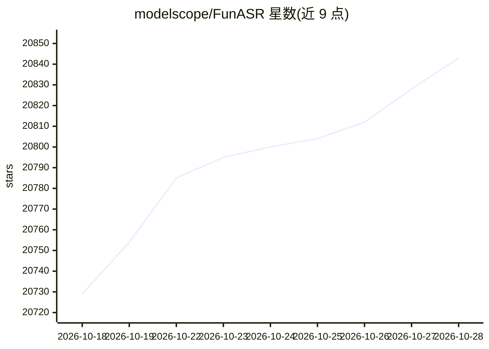

# modelscope/FunASR

⭐ 20,861 · Python · MIT · 推送 2026-10-28 · [GitHub](https://github.com/modelscope/FunASR) · [官网](www.funasr.com) · 组织维护 · 中文 README

**面向开发者的语音识别工具包：训练/推理/流式 ASR 与部署服务**

FunASR 是一个语音识别工具包，将任务、checkpoint 与运行时分开选择：提供文件转写、流式转写、VAD、标点、说话人分离、情感与音频事件识别等 pipeline，模型库含 SenseVoiceSmall、Paraformer、Fun-ASR-Nano 等。支持 Python AutoModel、CLI、OpenAI 兼容 HTTP 服务、Docker 流式服务、vLLM 批处理加速以及 llama.cpp/GGUF 的无 Python 边缘部署，并提供 MCP Server 供 Claude/Cursor 等 agent 调用。工具包本身为 MIT 许可，第三方模型许可单独约定。

## 筛选速览

| 维度 | 判定 | 备注 |
|---|---|---|
| AI 角色 | `ai-ecosystem` | LLM/agent 周边工具 |
| 许可风险 | `permissive` | MIT |
| 部署形态 | `self-host` | docker 或自建部署 |
| 模型依赖 | local-ok | 支持本地模型 |
| 硬件要求 | `cpu-ok` | |
| 安装摩擦 | `low` | 无编译、无系统依赖或容器化 |
| 成熟度 | — | 结构信号不足 |

## 动量与使用信号

- 维护:`active` — 距上次 push 1.2 天,年发版 61,202 位贡献者
- 涨星:近 1 天 **+12**(自 20261016 起算)
- 安装:pypi 包 `funasr` 月下载 272,534
- 平台:— · 协议:OPENAI-API / MCP

## 能力要点

- 任务/checkpoint/运行时分离的工具包架构，含模型选择与部署矩阵指南
- 多种部署路径：Python、CLI、OpenAI 兼容服务、Docker、vLLM、llama.cpp/GGUF
- 提供 MCP Server 与 OpenAI API 接入 LangChain/Dify/AutoGen 等 agent 框架
- GPU（CUDA/Vulkan）与 CPU/边缘设备的预编译二进制分发

## 适用场景

- 为中文/多语言音频做文件转写、标点与说话人分段
- 部署实时流式 ASR 的 WebSocket 服务
- 在无 GPU 的边缘设备上以 GGUF 二进制运行语音识别
- 把语音转写接入 Claude/Cursor 等 agent 工作流

## 场景标签

`语音识别` · 领域:感知与多模态

## 证据(README 行号)

> L5:  Industrial speech recognition toolkit for offline, streaming, and edge deployment.
> L6:  ASR · VAD · punctuation · speaker pipelines · emotion and audio-event models · OpenAI-compatible serving
> L112: FunASR is a toolkit: choose the task, checkpoint, and runtime separately.

## 星数曲线

2026-10-18 20,729 → 2026-10-28 20,843（+114）

---
*卡片 v1 · prompt 1.4 · 生成 2026-10-18 · 置信度 high · 依据 README sha `db1b5389252b` · [字段定义](../../DATASET.md)*
