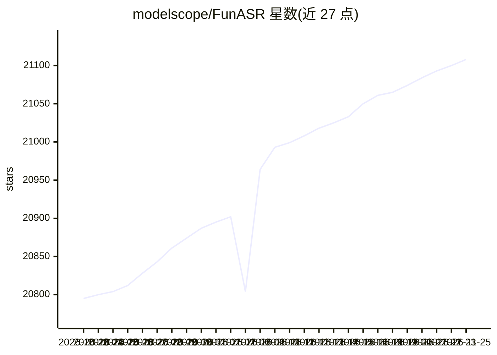

# modelscope/FunASR

⭐ 21,108 · Python · MIT · 推送 2026-11-23 · [GitHub](https://github.com/modelscope/FunASR) · [官网](www.funasr.com) · 组织维护 · 中文 README

**面向工业与边缘部署的语音识别工具包，覆盖训练推理与流式服务**

FunASR 是一个语音识别工具包，将任务、checkpoint 与运行时解耦选择：提供离线/流式转写、VAD、标点、说话人聚类、情感与音频事件识别等 pipeline，Model Zoo 含 Paraformer、SenseVoiceSmall、Fun-ASR-Nano 及第三方模型。可通过 Python AutoModel、CLI、OpenAI 兼容 HTTP 服务、MCP Server 或 llama.cpp/GGUF 预编译二进制部署，支持 CPU、GPU 与 Vulkan/CUDA。模型许可与工具包 MIT 许可分离。

## 筛选速览

| 维度 | 判定 | 备注 |
|---|---|---|
| AI 角色 | `ai-native` | 本体是模型或模型工具 |
| 许可风险 | `permissive` | MIT |
| 部署形态 | `self-host` | docker 或自建部署 |
| 模型依赖 | local-ok | 支持本地模型 |
| 硬件要求 | `cpu-ok` | |
| 安装摩擦 | `low` | 无编译、无系统依赖或容器化 |
| 成熟度 | — | 结构信号不足 |

## 动量与使用信号

- 维护:`active` — 距上次 push 1.2 天,年发版 61,202 位贡献者
- 涨星:近 1 天 **+12**(自 20261016 起算)
- 安装:pypi 包 `funasr` 月下载 272,534
- 平台:— · 协议:OPENAI-API / MCP

## 能力要点

- 任务/checkpoint/运行时解耦：转写、流式、VAD、标点、说话人 pipeline 可组合
- OpenAI 兼容 API、MCP Server（Claude/Cursor）与 CLI 转写入口
- llama.cpp/GGUF 单文件二进制支持 CPU/边缘设备，含 Vulkan 与 CUDA Windows 包
- Model Zoo 覆盖中英日韩粤及 31 语言多语种 checkpoint

## 适用场景

- 把中文/多语种录音批量转写成带时间戳与标点的文本
- 部署本地流式实时 ASR 的 WebSocket 服务
- 为 Claude/Cursor 等 agent 接入语音转写 MCP 服务
- 在无 GPU、无 Python 的边缘设备上运行 SenseVoice 转写

## 场景标签

`语音识别` · 领域:感知与多模态

## 证据(README 行号)

> L5:  Industrial speech recognition toolkit for offline, streaming, and edge deployment.
> L112: FunASR is a toolkit: choose the task, checkpoint, and runtime separately.
> L233: Run **SenseVoice / Paraformer / Fun-ASR-Nano** as a **single self-contained binary** on CPU and edge devices — thi

## 星数曲线

2026-10-23 20,795 → 2026-11-25 21,108（+313）

---
*卡片 v1 · prompt 1.4 · 生成 2026-11-24 · 置信度 high · 依据 README sha `47f70fe23649` · [字段定义](../../DATASET.md)*
