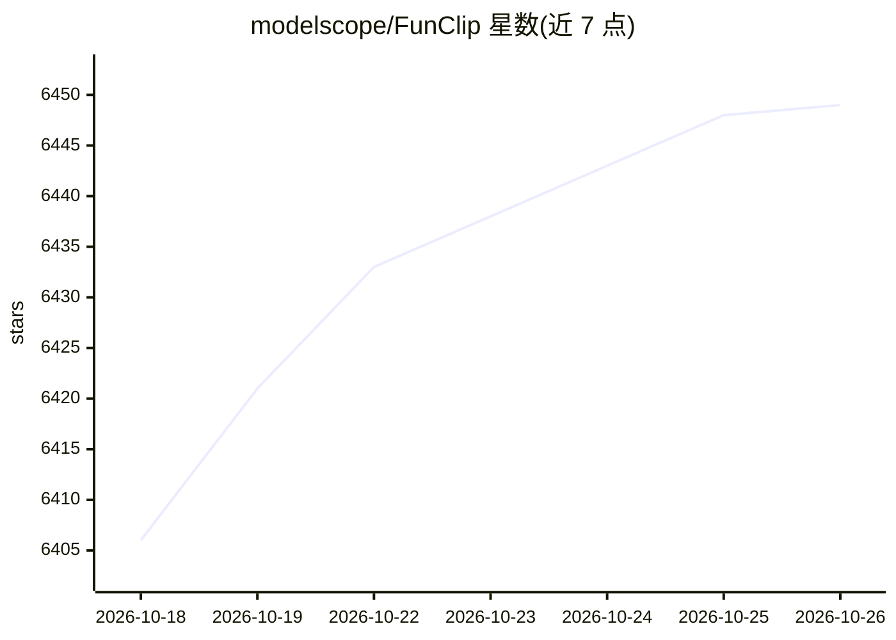

# modelscope/FunClip

⭐ 6,449 · Python · MIT · 推送 2026-10-08 · [GitHub](https://github.com/modelscope/FunClip) · [官网](https://huggingface.co/spaces/FunAudioLLM/FunClip) · 组织维护 · 中文 README

**本地部署的视频转写、字幕与 LLM 剪辑工具（Gradio UI）**

FunClip 是开源、本地部署的自动化视频剪辑工具：调用 FunASR 的 Paraformer 系列模型对视频做语音识别与时间戳预测，用户在识别结果中选取文本片段或说话人后点击剪辑得到对应视频片段，并生成 SRT 字幕。支持热词定制（SeACo-Paraformer）、CAM++ 说话人识别与按说话人剪辑；可通过 LLM（含 OrcaRouter/Cheaper Inference 网关与 TwelveLabs Pegasus 视频理解模型）辅助选段。以 Gradio 界面本地或服务器部署，也提供命令行方式；可选 MOSS-Transcribe-Diarize 长音频路径（第三方模型，vLLM 后端）。限制：精确任意文本剪辑仍需 Paraformer 的 token 时间戳。

## 筛选速览

| 维度 | 判定 | 备注 |
|---|---|---|
| AI 角色 | `ai-native` | 本体是模型或模型工具 |
| 许可风险 | `permissive` | MIT |
| 部署形态 | `desktop` | 安装包/桌面程序 |
| 模型依赖 | local-ok | 支持本地模型 |
| 硬件要求 | — | 无带数字的原话,不猜 |
| 安装摩擦 | `low` | 无编译、无系统依赖或容器化 |
| 成熟度 | — | 结构信号不足 |

## 能力要点

- Paraformer-Large 中文 ASR 与一体化时间戳预测，支持热词定制
- CAM++ 说话人识别，可按说话人剪辑并输出多段 SRT 字幕
- LLM 辅助剪辑：可选 OrcaRouter/Cheaper Inference 网关或 TwelveLabs Pegasus 视频理解模型
- Gradio 本地服务部署，另有命令行使用方式

## 适用场景

- 从会议或大会视频中按文本片段剪辑并生成字幕
- 按说话人剪出特定发言者的视频片段
- 让 LLM 根据转写内容自动挑选亮点片段

## 场景标签

`语音识别` `图像视频处理` · 领域:感知与多模态

## 证据(README 行号)

> L16: **FunClip** is a fully open-source, locally deployed automated video clipping tool. It leverages Alibaba TONGYI spe
> L20: - 🔥Try AI clipping using LLM in FunClip now.

## 星数曲线

2026-10-18 6,406 → 2026-10-26 6,449（+43）

---
*卡片 v1 · prompt 1.4 · 生成 2026-10-20 · 置信度 mid · 依据 README sha `be53cd4c20e2` · [字段定义](../../DATASET.md)*
