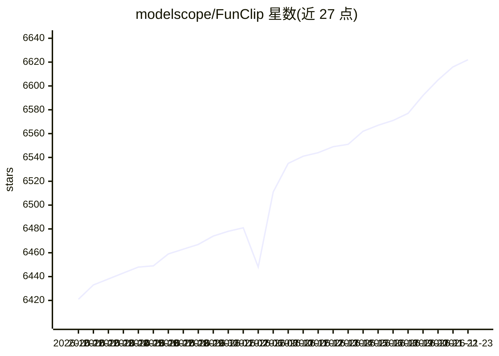

# modelscope/FunClip

⭐ 6,622 · Python · MIT · 推送 2026-11-01 · [GitHub](https://github.com/modelscope/FunClip) · [官网](https://huggingface.co/spaces/FunAudioLLM/FunClip) · 组织维护 · 中文 README

**给内容创作者：本地视频转录、字幕生成与 LLM 辅助切片工具**

FunClip 是本地部署的自动化视频切片工具，基于 FunASR Paraformer 系列模型对视频做语音识别，用户从识别结果中选取文本片段或说话人，点击切片获得对应视频段，并输出整段与目标段 SRT 字幕。集成 SeACo-Paraformer 热词定制与 CAM++ 说话人识别；LLM 辅助切片通过可选网关配置 API key 使用。以 Gradio 提供本地网页界面，也可部署在服务器浏览器访问，另支持命令行与 Modelscope/HuggingFace Space 在线体验；模型权重在启动时单独下载，源码包不含。

## 筛选速览

| 维度 | 判定 | 备注 |
|---|---|---|
| AI 角色 | `ai-native` | 本体是模型或模型工具 |
| 许可风险 | `permissive` | MIT |
| 部署形态 | `desktop` | 安装包/桌面程序 |
| 模型依赖 | local-ok | 支持本地模型 |
| 硬件要求 | — | 无带数字的原话,不猜 |
| 安装摩擦 | `low` | 无编译、无系统依赖或容器化 |
| 成熟度 | — | 结构信号不足 |

## 能力要点

- Paraformer-Large 中文语音识别并一体化预测时间戳
- SeACo-Paraformer 热词定制与 CAM++ 说话人识别切片
- 多段自由切片并自动输出全片与目标段 SRT 字幕
- 可选 MOSS（vLLM 后端）与 TwelveLabs Pegasus 视频理解模型路径

## 适用场景

- 上传视频后按文本片段或说话人剪出片段并生成字幕
- 为中文视频做带时间戳的语音转录
- 用热词定制提升人名、实体词的识别结果
- 在服务器上部署 Gradio 服务供浏览器访问

## 场景标签

`语音识别` `图像视频处理` · 领域:感知与多模态

## 证据(README 行号)

> L16: **FunClip** is a fully open-source, locally deployed automated video clipping tool. It leverages Alibaba TONGYI spe
> L20: - 🔥Try AI clipping using LLM in FunClip now.
> L24: - The functionalities are realized through Gradio interaction, offering simple installation and ease of use. It can

## 星数曲线

2026-10-21 6,421 → 2026-11-23 6,622（+201）

---
*卡片 v1 · prompt 1.4 · 生成 2026-11-22 · 置信度 mid · 依据 README sha `2057e572c0c7` · [字段定义](../../DATASET.md)*
