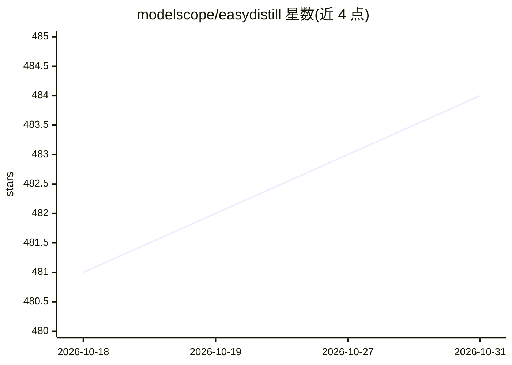

# modelscope/easydistill

⭐ 484 · Python · Apache-2.0 · 推送 2026-09-25 · [GitHub](https://github.com/modelscope/easydistill) · 组织维护 · 中文 README

**面向 LLM 的配置驱动知识蒸馏工具包：把黑盒教师模型变成训练数据**

ModelScope 维护的配置驱动知识蒸馏工具包，把生成、评估、过滤、改写、平衡与偏好评分等原子算子组合为端到端流水线，产出 SFT 数据集、DPO 偏好对与多模态训练数据。生成后端为 OpenAI 兼容端点（OpenAI API、Azure OpenAI、vLLM、本地服务、PAI-Token、PAI-EAS）。覆盖指令蒸馏、思维链、多模态、Agent 轨迹、文生图与文生视频等场景，导出格式可直接用于 LLaMA-Factory 与 ms-swift。通过统一 CLI 与 job_type 配置驱动，每个阶段亦可独立运行。2.0 为重写版本，与 1.0 配置和 API 不向后兼容。

## 筛选速览

| 维度 | 判定 | 备注 |
|---|---|---|
| AI 角色 | `ai-ecosystem` | LLM/agent 周边工具 |
| 许可风险 | `permissive` | Apache-2.0 |
| 部署形态 | `library` | 以包/库形式分发 |
| 模型依赖 | local-ok | 支持本地模型 |
| 硬件要求 | — | 无带数字的原话,不猜 |
| 安装摩擦 | `low` | 无编译、无系统依赖或容器化 |
| 成熟度 | — | 结构信号不足 |

## 能力要点

- 原子算子可组合为端到端流水线，各阶段亦以独立 job_type 透出，支持断点续跑
- 支持 SFT 数据集、DPO 偏好对与多模态（视觉对话/Agent 轨迹/文生图/文生视频）训练数据构建
- 生成后端无关：任意 OpenAI 兼容端点（OpenAI/Azure/vLLM/本地服务/PAI-Token/PAI-EAS）
- 内置 LLM/VLM 裁判评估，可对已有数据集打分而无需重新生成

## 适用场景

- 用黑盒教师模型批量生成 SFT/DPO 训练数据
- 构建多模态（含文生图、文生视频）蒸馏数据集
- 合成并展开多轮 Agent 与多跳搜索 ReAct 轨迹训练数据
- 对已有数据集用 LLM/VLM 裁判打分与过滤

## 场景标签

 · 领域:LLM 训练数据/知识蒸馏

## 证据(README 行号)

> L3: EasyDistill 2 is a config-driven knowledge distillation toolkit for turning black-box teacher models into high-quali
> L11: - **Backend-agnostic generation / 后端无关的生成**: works with any OpenAI-compatible endpoint—OpenAI API, Azure OpenAI, vL

## 星数曲线

2026-10-18 481 → 2026-10-31 484（+3）

---
*卡片 v1 · prompt 1.4 · 生成 2026-10-21 · 置信度 high · 依据 README sha `a55dc7d72702` · [字段定义](../../DATASET.md)*
