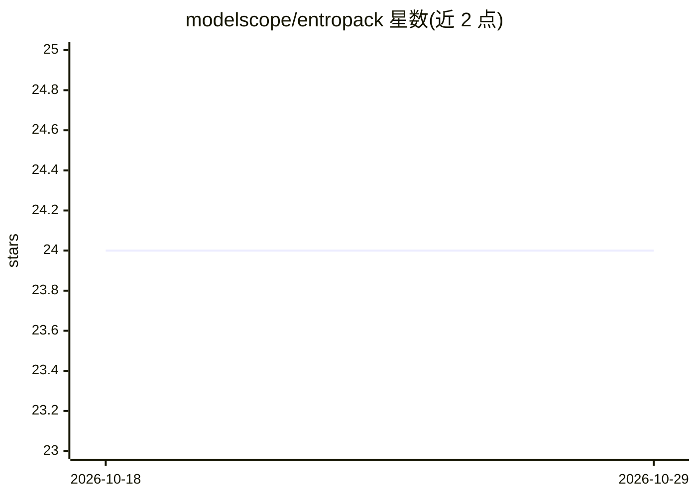

# modelscope/entropack

⭐ 24 · Python · Apache-2.0 · 推送 2026-10-23 · [GitHub](https://github.com/modelscope/entropack) · 组织维护 · 中文 README

**PyTorch 张量压缩库：无损/有损压缩模型权重**

面向 PyTorch 的通用张量压缩库，提供无损压缩（DFloat11、tile-ANS）与任意非整数目标码率（0.001–11 bpp）的有损压缩，GPU 编解码后恢复原始 shape 与 dtype。支持 16 种浮点/整数/布尔 dtype（FP32/BF16/FP16/FP8/INT8 等）。提供 CompressedLinear 将 torch.nn.Linear 权重压缩替换，可随 state_dict 保存；GPU 编解码依赖 CUDA 版 PyTorch 2.10+ 与 CuPy。另在 ModelScope 发布多个扩散模型的预量化权重包，可经 DiffSynth-Studio 加载。

## 筛选速览

| 维度 | 判定 | 备注 |
|---|---|---|
| AI 角色 | `ai-ecosystem` | LLM/agent 周边工具 |
| 许可风险 | `permissive` | Apache-2.0 |
| 部署形态 | `library` | 以包/库形式分发 |
| 模型依赖 | — | README 未给出锁定关系 |
| 硬件要求 | — | 无带数字的原话,不猜 |
| 安装摩擦 | `medium` | 含编译或系统依赖之一 |
| 成熟度 | — | 结构信号不足 |

## 能力要点

- 无损与有损压缩，目标码率支持 0.001–11 bpp 非整数
- 支持 FP32/BF16/FP16/FP8/INT8 等 16 种 dtype
- CompressedLinear 可替换 torch.nn.Linear 并随 state_dict 保存
- 提供 Z-Image-Turbo/Qwen-Image-2.1/MiniMax-H3 预量化权重包

## 适用场景

- 压缩大模型权重以降低存储体积
- 以 CompressedLinear 替换线性层做低比特推理
- 需要精确恢复的 BF16 权重无损归档

## 场景标签

`模型量化` · 领域:训练与推理

## 证据(README 行号)

> L5: EntroPack is a general-purpose tensor compression library for PyTorch. It supports lossless
> L70: `CompressedLinear.from_linear` compresses an existing `torch.nn.Linear`'s weights using

## 星数曲线

2026-10-18 24 → 2026-10-29 24（+0）

---
*卡片 v1 · prompt 1.4 · 生成 2026-10-27 · 置信度 high · 依据 README sha `def6387fd23c` · [字段定义](../../DATASET.md)*
