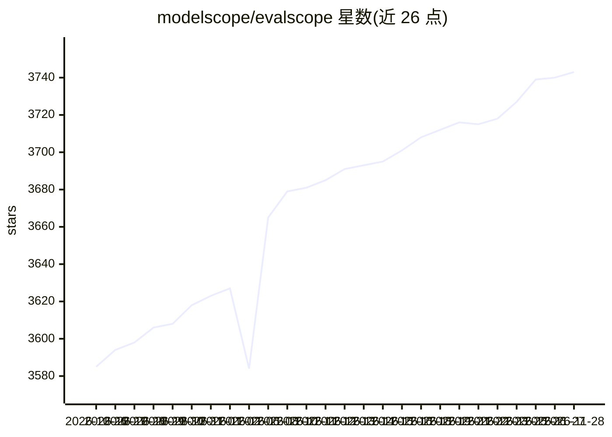

# modelscope/evalscope

⭐ 3,743 · Python · Apache-2.0 · 推送 2026-11-27 · [GitHub](https://github.com/modelscope/evalscope) · [官网](https://modelscope.github.io/evalscope/) · 组织维护 · 中文 README

**给开发者的大模型评测与性能压测一站式框架**

ModelScope 社区构建的 LLM 评测框架，一条命令即可启动模型能力评测、推理性能压测与结果可视化。内置 MMLU、C-Eval、GSM8K 等基准，支持 LLM、VLM、Embedding、Reranker、AIGC 等模型类型，可接入 OpenCompass、VLMEvalKit、RAGEval 等评测后端；提供 Agent 评测模式（多轮 AgentLoop、Docker/E2B 沙箱、完整 Trace 记录）、Arena 多模型对战排名与 Web Dashboard 报告。通过 pip 安装，经 OpenAI 兼容 API 或 Anthropic API 调用被测模型，开发者可自定义数据集、模型与指标。

## 筛选速览

| 维度 | 判定 | 备注 |
|---|---|---|
| AI 角色 | `ai-ecosystem` | LLM/agent 周边工具 |
| 许可风险 | `permissive` | Apache-2.0 |
| 部署形态 | `library` | 以包/库形式分发 |
| 模型依赖 | locked-api |  |
| 硬件要求 | — | 无带数字的原话,不猜 |
| 安装摩擦 | `low` | 无编译、无系统依赖或容器化 |
| 成熟度 | — | 结构信号不足 |

## 能力要点

- 内置 MMLU、C-Eval、GSM8K 等评测基准，一条命令启动评测
- 支持 LLM/VLM/Embedding/Reranker/AIGC 多类模型评测
- Agent 评测模式：多轮 AgentLoop、Docker/E2B 沙箱、逐样本 Trace 记录
- 推理性能压测（TTFT/TPOT 等）与 Web Dashboard 可视化报告

## 适用场景

- 发布前对不同 LLM 跑基准测试并生成对比报告
- 对模型服务做推理性能压测（TTFT/TPOT/吞吐量）
- 在沙箱中运行 SWE-bench 等代码/Agent 任务基准
- 多模型 Pairwise 对战排名（Arena Mode）

## 场景标签

`模型评测` · 领域:评测与运维

## 证据(README 行号)

> L16: EvalScope is a one-stop LLM evaluation framework built by the ModelScope Community. Just one command to start — it 
> L28: - **🚀 Multi-backend Integration**: Seamlessly integrates multiple evaluation backends including OpenCompass, VLMEva
> L29: - **🤖 Agent Evaluation Mode**: Drives benchmarks (e.g. GSM8K, AIME, SWE-bench Agentic) inside a controlled multi-tu

## 星数曲线

2026-10-26 3,585 → 2026-11-28 3,743（+158）

---
*卡片 v1 · prompt 1.4 · 生成 2026-11-28 · 置信度 high · 依据 README sha `eaf8edaf0af8` · [字段定义](../../DATASET.md)*
