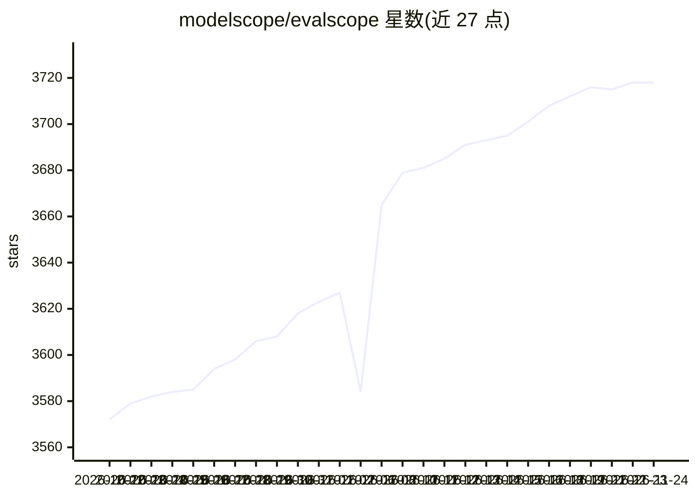

# modelscope/evalscope

⭐ 3,727 · Python · Apache-2.0 · 推送 2026-11-23 · [GitHub](https://github.com/modelscope/evalscope) · [官网](https://modelscope.github.io/evalscope/) · 组织维护 · 中文 README

**开发者用的 LLM/VLM/AIGC 评估与性能压测框架**

ModelScope 社区构建的一站式大模型评估框架，一条命令即可启动模型能力评测、推理性能压力测试与结果可视化。内置 MMLU、C-Eval、GSM8K 等评测基准，支持 LLM、VLM、Embedding、Reranker、AIGC 等模型类型；集成 OpenCompass、VLMEvalKit、RAGEval 等评测后端；提供多轮 AgentLoop 评测模式（支持 Docker/E2B 沙箱）、Arena 多模型对战、Web Dashboard 报告可视化，以及 TTFT/TPOT 等性能指标压测。通过 pip 安装，经 OpenAI 兼容 API 或 Anthropic API 接入被评模型。

## 筛选速览

| 维度 | 判定 | 备注 |
|---|---|---|
| AI 角色 | `ai-ecosystem` | LLM/agent 周边工具 |
| 许可风险 | `permissive` | Apache-2.0 |
| 部署形态 | `library` | 以包/库形式分发 |
| 模型依赖 | locked-api |  |
| 硬件要求 | — | 无带数字的原话,不猜 |
| 安装摩擦 | `low` | 无编译、无系统依赖或容器化 |
| 成熟度 | — | 结构信号不足 |

## 能力要点

- 一条命令运行评测：pip 安装后经 OpenAI 兼容 API 调用，内置 MMLU、C-Eval、GSM8K 等基准
- Agent 评测模式：多轮 AgentLoop 驱动 SWE-bench Agentic 等基准，支持 Docker/E2B 沙箱并记录 Agent Trace
- 推理性能压测：TTFT、TPOT、吞吐量等指标，支持多轮对话负载测试
- Web Dashboard 多维模型对比、Arena 多模型对战排名

## 适用场景

- 上线前用统一基准批量评估多个模型的文本/多模态能力
- 对模型服务做并发压测并跟踪 TTFT、TPOT、吞吐量
- 在沙箱中跑 SWE-bench、τ-bench 等 agent 任务并可视化轨迹
- 组织多模型 Pairwise 对战做人工偏好排序

## 场景标签

`模型评测` · 领域:评测与运维

## 证据(README 行号)

> L16: EvalScope is a one-stop LLM evaluation framework built by the ModelScope Community. Just one command to start — it 
> L28: - **🚀 Multi-backend Integration**: Seamlessly integrates multiple evaluation backends including OpenCompass, VLMEva
> L30: - **⚡ Inference Performance Testing**: Provides powerful model service stress testing tools, supporting multiple pe

## 星数曲线

2026-10-22 3,572 → 2026-11-24 3,718（+146）

---
*卡片 v1 · prompt 1.4 · 生成 2026-11-23 · 置信度 high · 依据 README sha `c4c65a865469` · [字段定义](../../DATASET.md)*
