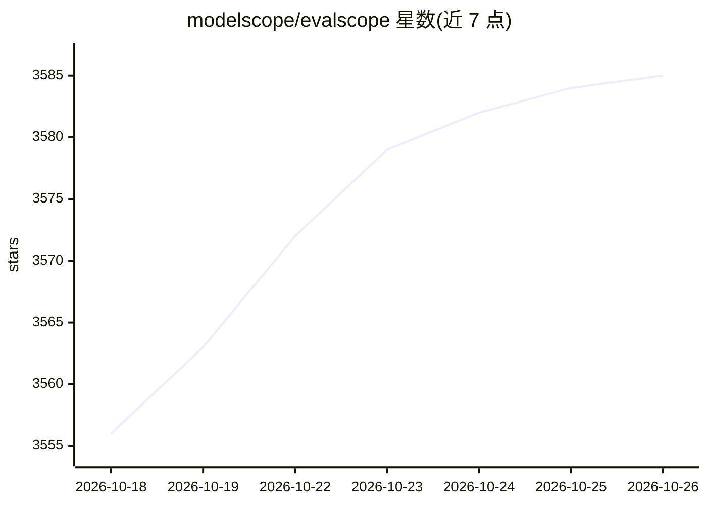

# modelscope/evalscope

⭐ 3,585 · Python · Apache-2.0 · 推送 2026-10-23 · [GitHub](https://github.com/modelscope/evalscope) · [官网](https://modelscope.github.io/evalscope/) · 组织维护 · 中文 README

**ModelScope 社区的大模型评测与性能压测一站式框架**

面向 LLM/VLM/Embedding/AIGC 模型的一站式评测框架：一条命令即可运行 MMLU、C-Eval、GSM8K 等内置基准的能力评测，并提供推理性能压测（TTFT、TPOT、吞吐等指标）与 Web Dashboard 多维对比可视化。支持多评测后端集成（OpenCompass、VLMEvalKit、RAGEval），提供 Agent 评测模式（多轮 AgentLoop、Docker 沙箱、轨迹记录）、Arena 多模型对战模式，以及通过 OpenAI/Anthropic API 评测在线模型服务。以 pip 安装的 Python 工具形式提供，开发者可自定义数据集、模型与指标。

## 筛选速览

| 维度 | 判定 | 备注 |
|---|---|---|
| AI 角色 | `ai-ecosystem` | LLM/agent 周边工具 |
| 许可风险 | `permissive` | Apache-2.0 |
| 部署形态 | `library` | 以包/库形式分发 |
| 模型依赖 | locked-api |  |
| 硬件要求 | — | 无带数字的原话,不猜 |
| 安装摩擦 | `low` | 无编译、无系统依赖或容器化 |
| 成熟度 | — | 结构信号不足 |

## 能力要点

- 内置 MMLU、C-Eval、GSM8K 等多行业基准的能力评测
- 推理性能压测：TTFT/TPOT/吞吐指标，支持多轮对话与 Embedding/Rerank 服务压测
- Agent 评测模式：多轮 AgentLoop、可插拔策略与工具、Docker 沙箱、逐样本轨迹可视化
- React+Vite Web Dashboard 与 Arena 多模型对战模式

## 适用场景

- 对自研或第三方模型服务跑基准评测并出可视化报告
- 对模型 API 服务做性能压测，测量 TTFT/TPOT 与吞吐
- 在受控 AgentLoop 中评测模型的工具调用与代码能力
- 多模型两两对战并生成排名

## 场景标签

`模型评测` · 领域:评测与运维

## 证据(README 行号)

> L16: EvalScope is a one-stop LLM evaluation framework built by the ModelScope Community. Just one command to start — it 
> L28: - **🚀 Multi-backend Integration**: Seamlessly integrates multiple evaluation backends including OpenCompass, VLMEva

## 星数曲线

2026-10-18 3,556 → 2026-10-26 3,585（+29）

---
*卡片 v1 · prompt 1.4 · 生成 2026-10-20 · 置信度 high · 依据 README sha `7e467742a970` · [字段定义](../../DATASET.md)*
