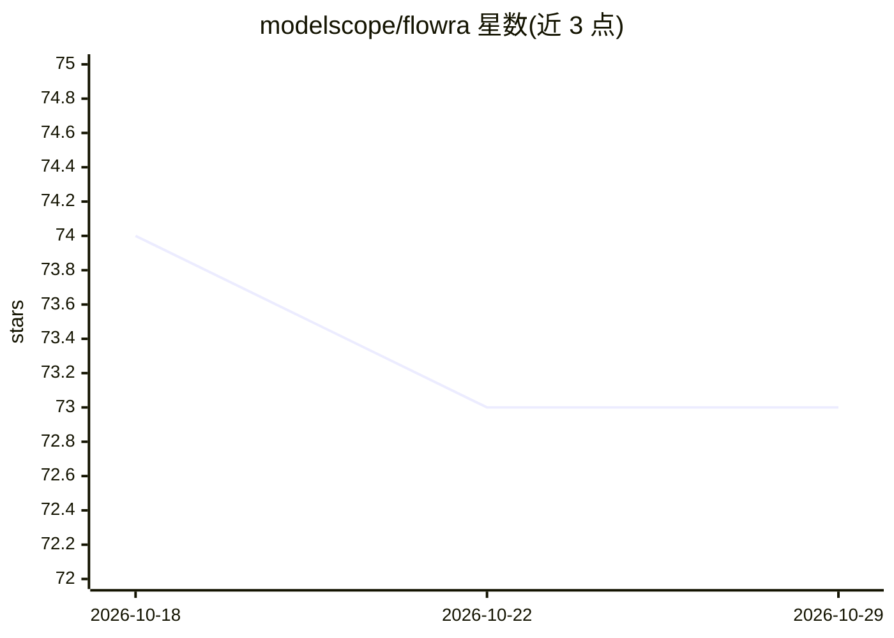

# modelscope/flowra

⭐ 73 · Python · NOASSERTION · 推送 2025-11-24 · [GitHub](https://github.com/modelscope/flowra) · 组织维护 · 中文 README

**FlowBench 的图执行引擎与节点包开发工具链**

面向开发者的 DAG 图执行引擎和节点包开发工具：提供项目创建、节点组管理、构建、调试全流程命令，开发者可将机器学习模型、图像处理算法等封装为节点，构建 .nodebin 文件后导入 FlowBench 客户端在画布中使用。内置 ModelScope 模型下载管理，支持 OSS/MinIO 对象存储后端，类型系统覆盖图像、视频、音频与 3D 网格等多媒体数据，执行引擎支持节点缓存与分布式执行。以 Python 包（3.10+）通过 pip 安装。

## 筛选速览

| 维度 | 判定 | 备注 |
|---|---|---|
| AI 角色 | `ai-ecosystem` | LLM/agent 周边工具 |
| 许可风险 | `none` | NOASSERTION |
| 部署形态 | `library` | 以包/库形式分发 |
| 模型依赖 | — | README 未给出锁定关系 |
| 硬件要求 | — | 无带数字的原话,不猜 |
| 安装摩擦 | `low` | 无编译、无系统依赖或容器化 |
| 成熟度 | — | 结构信号不足 |

## 能力要点

- DAG 节点系统与全生命周期开发命令（create/project/build/debug）
- 内置 ModelScope 模型下载与管理功能
- 支持节点缓存、分布式执行的执行引擎
- 类型系统覆盖图像/视频/音频/3D 网格多媒体数据

## 适用场景

- 把机器学习模型或图像算法封装成 FlowBench 可用节点
- 在可视化画布中编排自定义节点工作流
- 为 FlowBench 开发并发布节点包

## 场景标签

`工作流自动化` · 领域:效率与自动化

## 证据(README 行号)

> L13: Flowra is the core graph execution engine and node package development tool for FlowBench. It provides developers w
> L21: - **Model Integration**: Built-in ModelScope model download and management functionality
> L164: - **YOLO Node**: Object detection using YOLO model

## 星数曲线

2026-10-18 74 → 2026-10-29 73（-1）

---
*卡片 v1 · prompt 1.4 · 生成 2026-10-24 · 置信度 high · 依据 README sha `2cc208a6eb37` · [字段定义](../../DATASET.md)*
