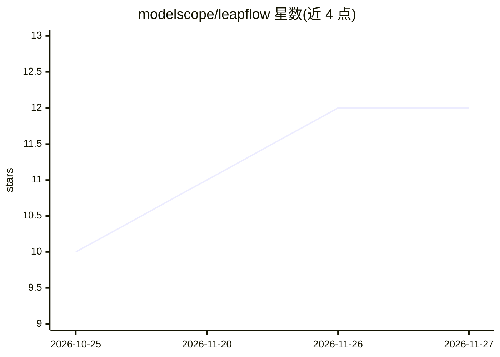

# modelscope/leapflow

⭐ 12 · Python · Apache-2.0 · 推送 2026-11-26 · [GitHub](https://github.com/modelscope/leapflow) · 组织维护 · 中文 README

**信号驱动的自进化 agent 框架，开发者接入 LLM 与硬件**

LeapFlow 将虚拟信号（IM、OS 事件、web）与物理信号（机械臂、深度相机、仪器、IoT）汇入统一管道，形成观察-学习-决策控制循环，技能、设备信任与环境理解跨会话累积。提供 TUI/CLI 交互、编程工具集、teach 技能蒸馏、LeapBoard 监控面板、IM Gateway、三层硬件协议栈与许可/审批治理机制。通过 pip 安装，LLM 后端接受任何 OpenAI 兼容端点。

## 筛选速览

| 维度 | 判定 | 备注 |
|---|---|---|
| AI 角色 | `ai-ecosystem` | LLM/agent 周边工具 |
| 许可风险 | `permissive` | Apache-2.0 |
| 部署形态 | `library` | 以包/库形式分发 |
| 模型依赖 | — | README 未给出锁定关系 |
| 硬件要求 | — | 无带数字的原话,不猜 |
| 安装摩擦 | `low` | 无编译、无系统依赖或容器化 |
| 成熟度 | — | 结构信号不足 |

## 能力要点

- 虚拟与物理信号经统一管道进入观察-学习-决策循环，知识跨会话累积
- teach 命令录制操作并蒸馏为参数化技能（DRAFT→CANDIDATE→VERIFIED→PRODUCTION）
- 三层硬件协议栈（LHP/HCP/南向传输插件）与签名执行许可、节点本地急停等治理机制
- Gateway 可将飞书、钉钉、Telegram、Slack 等 IM 通道转为信号边界

## 适用场景

- 让 agent 长期管理代码仓库并自动沉淀技能
- 通过对话将 IM 群消息接入统一 agent 工作流
- 控制机械臂、深度相机等边缘设备并记录训练 episode

## 场景标签

`Agent 框架` · 领域:Agent 开发

## 证据(README 行号)

> L5: LeapFlow is a signal-driven, self-evolving agent framework. Virtual signals (IM apps, OS events, web) and physical s
> L255: |`LLMProviderPlugin`|LLM inference backend|

## 星数曲线

2026-10-25 10 → 2026-11-27 12（+2）

---
*卡片 v1 · prompt 1.4 · 生成 2026-11-19 · 置信度 high · 依据 README sha `c753795c335b` · [字段定义](../../DATASET.md)*
