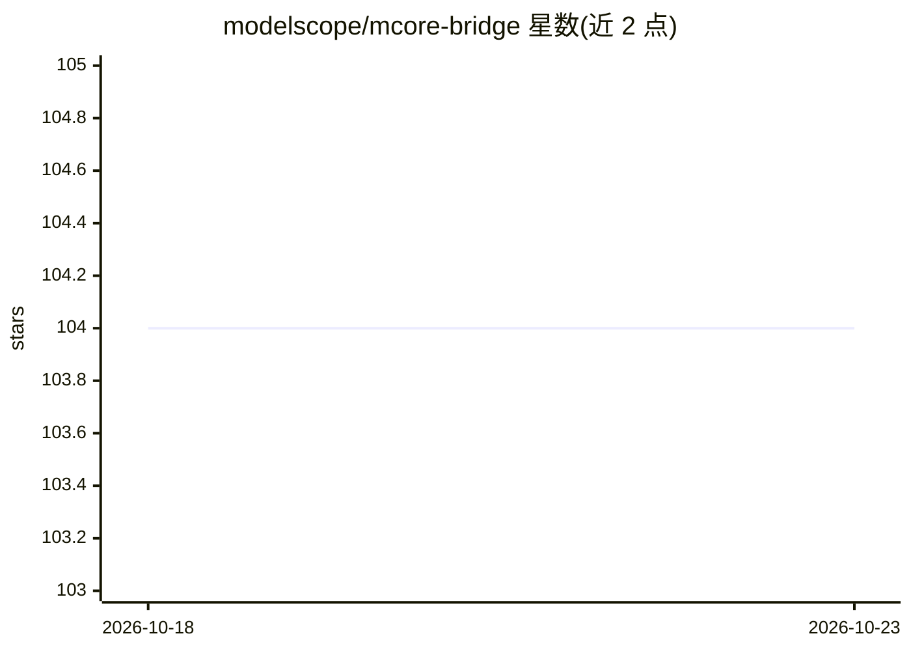

# modelscope/mcore-bridge

⭐ 104 · Python · Apache-2.0 · 推送 2026-10-15 · [GitHub](https://github.com/modelscope/mcore-bridge) · [官网](https://swift.readthedocs.io/en/latest/Megatron-SWIFT/Mcore-Bridge.html) · 组织维护 · 中文 README

**基于 Megatron-Core 的大模型定义库：让 Megatron 训练像 Transformers 一样简单**

ModelScope 社区开发的模型定义库，构建于 Megatron-Core 生态之上，提供 300+ 文本模型与 200+ 多模态模型（Qwen3-Next、DeepSeek-V4、GLM-5.1、Kimi-K2.5 等）的 Megatron 模型定义。支持全参数训练与 LoRA（兼容 PEFT）、多种 Megatron 并行策略、多模态 FP8 训练，可加载/保存 safetensors 权重并与 Transformers、vLLM、SGLang 对接；训练入口主要通过 ms-swift 使用，也提供 torchrun 程序化调用示例。硬件要求 A10/A100/H100/B200、RTX 及昇腾 NPU，运行环境需 python>=3.10、CUDA、torch>=2.0、megatron-core 等。

## 筛选速览

| 维度 | 判定 | 备注 |
|---|---|---|
| AI 角色 | `ai-ecosystem` | LLM/agent 周边工具 |
| 许可风险 | `permissive` | Apache-2.0 |
| 部署形态 | `library` | 以包/库形式分发 |
| 模型依赖 | local-ok | 支持本地模型 |
| 硬件要求 | — | 无带数字的原话,不猜 |
| 安装摩擦 | `medium` | 含编译或系统依赖之一 |
| 成熟度 | — | 结构信号不足 |

## 能力要点

- 300+ 文本模型与 200+ 多模态模型的 Megatron-Core 模型定义
- 全参数与 LoRA 训练，兼容 PEFT 生态
- 支持张量/流水线/序列/上下文/专家等多种并行策略
- 与 Transformers/vLLM/SGLang 推理框架的权重兼容

## 适用场景

- 用 Megatron-Core 对主流开源大模型做全参数或 LoRA 训练
- 配合 ms-swift 进行大模型微调
- 在 A100/H100/昇腾等多种硬件上做分布式训练

## 场景标签

`模型训练` `微调` `多模态` · 领域:感知与多模态

## 证据(README 行号)

> L22: **mcore-bridge** is a large language model and multimodal large model definition library built on the Megatron-Core
> L29: - **Parallelism Techniques**: Supports multiple parallelism strategies provided by Megatron-Core, including tensor 
> L36: - Integrating Mcore-Bridge with ms-swift

## 星数曲线

2026-10-18 104 → 2026-10-23 104（+0）

---
*卡片 v1 · prompt 1.4 · 生成 2026-10-23 · 置信度 high · 依据 README sha `a5b2c62836df` · [字段定义](../../DATASET.md)*
