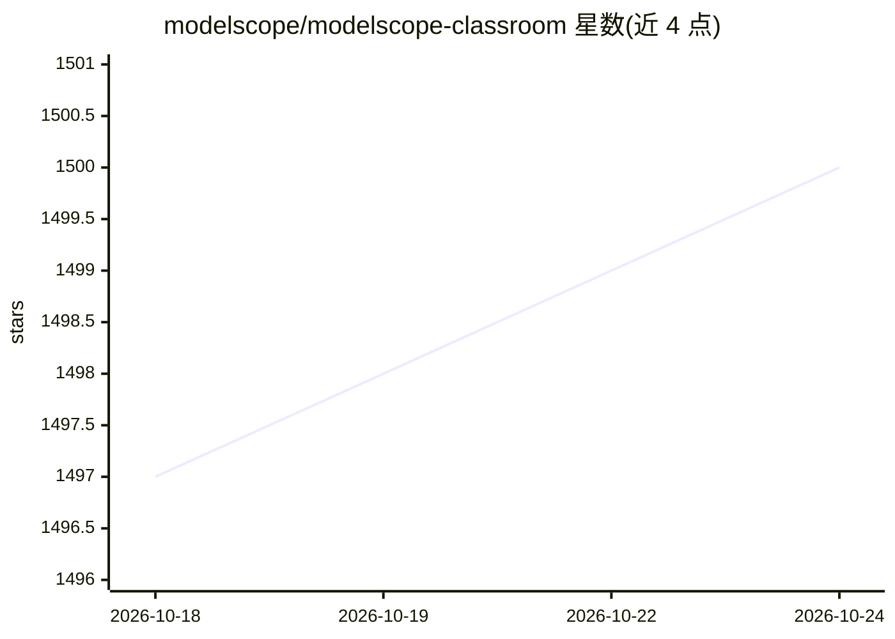

# modelscope/modelscope-classroom

⭐ 1,500 · Jupyter Notebook · Apache-2.0 · 推送 2026-04-27 · [GitHub](https://github.com/modelscope/modelscope-classroom) · 组织维护 · 中文 README

**魔搭社区深度学习与大模型教程合集（LLM/AIGC/RL/Agent）**

由 ModelScope 团队维护的教程与博客聚合仓库：集中大模型理论与实践课程（13 章节，含深度学习基础、训练推理、强化学习、智能体技术）、LLM 系列教程、AIGC（文生图/文生视频）教程与 Demo，以及 Ulysses+Ring-Attention、DeepResearch、All2All 全模态等前沿技术综述；另设 Articles 与 DailyPaper 频道，并持续更新 llama.cpp、vLLM、RAGFlow、LLaMA-Factory、unsloth、OpenRLHF 等工具的使用样例，面向学习训练、推理、部署与应用搭建的开发者。

## 筛选速览

| 维度 | 判定 | 备注 |
|---|---|---|
| AI 角色 | `ai-knowledge` | 知识聚合/清单类 |
| 许可风险 | `permissive` | Apache-2.0 |
| 部署形态 | `None` |  |
| 模型依赖 | — | README 未给出锁定关系 |
| 硬件要求 | — | 无带数字的原话,不猜 |
| 安装摩擦 | `low` | 无编译、无系统依赖或容器化 |
| 成熟度 | — | 结构信号不足 |

## 能力要点

- 13 章节大模型教程（深度学习基础、训练推理、强化学习、智能体）
- LLaMA-Factory/vLLM/RAGFlow/Dify/unsloth/OpenRLHF 等工具使用样例
- AIGC 文生图/文生视频系列教程与 Demo（DiT、ViViT、Diffusion）
- Articles 技术博客与 DailyPaper 频道

## 适用场景

- 系统学习大模型从基础到训练、推理、部署的流程
- 查找 llama.cpp/vLLM/LLaMA-Factory 等工具的实操样例
- 跟进 DeepResearch、全模态大模型等前沿技术综述

## 场景标签

`教程课程` · 领域:学习与行业

## 证据(README 行号)

> L7: 在这里我们集中了魔搭社区的深度学习教程！热爱AI的开发者们可以在这里找到自己想要了解的知识，并学会训练、推理、部署、应用搭建等各类常用操作！
> L11: - ⭐️**2026.04.21** 新增**大模型教程**，涵盖完整的大模型理论与实践课程，包括深度学习基础、模型训练推理、强化学习、智能体技术等13个章节，请查看大模型教程.

## 星数曲线

2026-10-18 1,497 → 2026-10-24 1,500（+3）

---
*卡片 v1 · prompt 1.4 · 生成 2026-10-21 · 置信度 high · 依据 README sha `532edcdfa6ed` · [字段定义](../../DATASET.md)*
