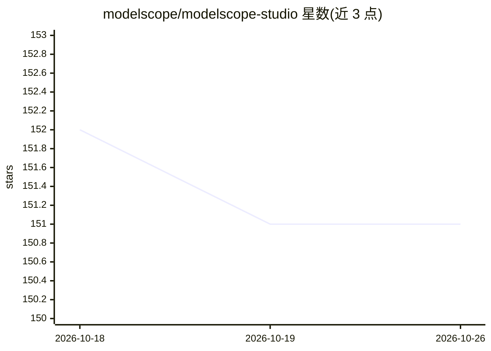

# modelscope/modelscope-studio

⭐ 151 · Python · Apache-2.0 · 推送 2026-10-09 · [GitHub](https://github.com/modelscope/modelscope-studio) · 组织维护 · 中文 README

**基于 Gradio 的第三方 UI 组件库，集成 Ant Design 等前端组件**

modelscope_studio 是基于 Gradio 的第三方组件库，将 Ant Design、Ant Design X、Monaco Editor 等 Web 前端组件引入 Gradio 应用，供开发者构建界面布局更灵活、组件形态更丰富的应用页面，主题标签含 chatbot（Ant Design X 提供聊天气泡等对话 UI 组件）。组件与原生 Gradio 组件可混用；需 Gradio >= 6.28.0（旧版 Gradio 需安装 1.x 版本）；在 Hugging Face Space 使用需设置 ssr_mode=False。提供文档站、示例与 gradio cc dev 本地开发流程。

## 筛选速览

| 维度 | 判定 | 备注 |
|---|---|---|
| AI 角色 | `ai-enhanced` | 去掉 AI 部分产品仍成立 |
| 许可风险 | `permissive` | Apache-2.0 |
| 部署形态 | `library` | 以包/库形式分发 |
| 模型依赖 | — | README 未给出锁定关系 |
| 硬件要求 | — | 无带数字的原话,不猜 |
| 安装摩擦 | `low` | 无编译、无系统依赖或容器化 |
| 成熟度 | — | 结构信号不足 |

## 能力要点

- 集成 Ant Design / Ant Design X / Monaco Editor 等前端组件
- 与原生 Gradio 组件可混合使用
- 针对不同 Gradio 版本提供对应安装版本（1.x / 2.x+）

## 适用场景

- 为 Gradio 应用构建更灵活的页面布局与界面
- 快速搭建包含对话式 UI 的 demo 应用
- 在 Gradio 中使用 Monaco Editor 等编辑器组件

## 场景标签

 · 领域:Web UI / 应用构建工具

## 证据(README 行号)

> L9: `modelscope_studio` is a third-party component library based on Gradio, offers developers more customized interface 
> L20: Compared to the original components of Gradio, `modelscope_studio` focuses more on page layout and component flexib

## 星数曲线

2026-10-18 152 → 2026-10-26 151（-1）

---
*卡片 v1 · prompt 1.4 · 生成 2026-10-22 · 置信度 mid · 依据 README sha `32a13608f04c` · [字段定义](../../DATASET.md)*
