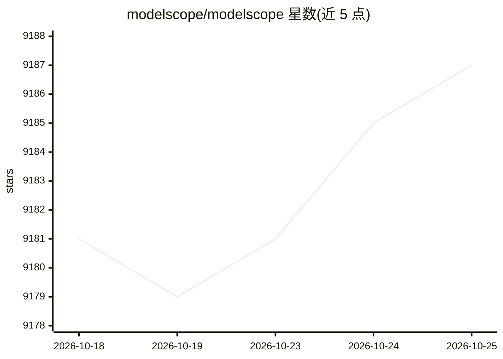

# modelscope/modelscope

⭐ 9,187 · Python · Apache-2.0 · 推送 2026-10-23 · [GitHub](https://github.com/modelscope/modelscope) · [官网](https://www.modelscope.cn/) · 组织维护 · 中文 README

**Model-as-a-Service 框架库：统一接口做模型推理/训练/评估**

ModelScope 官方开源 Python 库，围绕 Model-as-a-Service 理念，为 CV、NLP、语音、多模态、AI for Science 领域模型提供统一的 pipeline 推理接口与 Trainer 微调/评估接口；通过分层 API 支持模型贡献者集成模型，并与 ModelScope Model-Hub/Dataset-Hub 后端交互（实体查找、版本控制、缓存管理）。平台公开 700+ 模型，README 标注 Docker 镜像与 pip 安装两种途径；部分音频模型仅支持 Python3.7 + TF1.15 Linux 环境，Linux 下部分模型需手动安装 libsndfile。

## 筛选速览

| 维度 | 判定 | 备注 |
|---|---|---|
| AI 角色 | `ai-ecosystem` | LLM/agent 周边工具 |
| 许可风险 | `permissive` | Apache-2.0 |
| 部署形态 | `library` | 以包/库形式分发 |
| 模型依赖 | — | README 未给出锁定关系 |
| 硬件要求 | — | 无带数字的原话,不猜 |
| 安装摩擦 | `low` | 无编译、无系统依赖或容器化 |
| 成熟度 | — | 结构信号不足 |

## 能力要点

- pipeline 统一推理接口，数行代码完成各任务推理
- Trainer 支持微调与评估，含数据并行/模型并行/混合并行训练策略
- 覆盖 LLM、多模态、CV、语音、AI for Science 五类模型的模型生态接入
- 提供官方 CPU/GPU Docker 镜像，支持 PyTorch/TensorFlow/ONNX

## 适用场景

- 用几行代码加载并运行各领域模型的推理
- 对平台模型做微调与评估构建下游应用
- 基于官方 Docker 镜像免配置搭建训练/推理环境
- 模型贡献者将自有模型集成进 ModelScope 生态

## 场景标签

`微调` `推理引擎` · 领域:训练与推理

## 证据(README 行号)

> L19: ModelScope is built upon the notion of “Model-as-a-Service” (MaaS). It seeks to bring together most advanced machin
> L21: In particular, with rich layers of API-abstraction, the ModelScope library offers unified experience to explore sta

## 星数曲线

2026-10-18 9,181 → 2026-10-25 9,187（+6）

---
*卡片 v1 · prompt 1.4 · 生成 2026-10-20 · 置信度 high · 依据 README sha `9ed9c8676050` · [字段定义](../../DATASET.md)*
