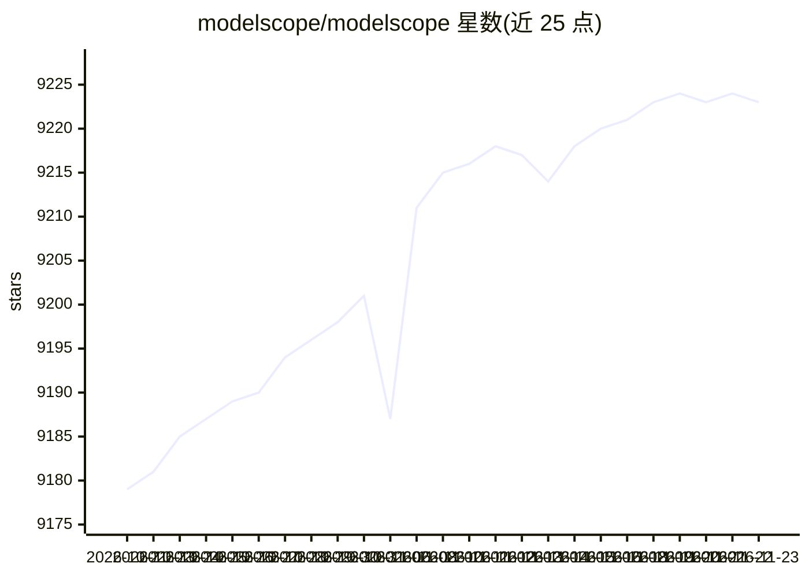

# modelscope/modelscope

⭐ 9,223 · Python · Apache-2.0 · 推送 2026-11-16 · [GitHub](https://github.com/modelscope/modelscope) · [官网](https://www.modelscope.cn/) · 组织维护 · 中文 README

**开发者用的 MaaS 模型推理/训练/评估库**

基于 Model-as-a-Service 理念的开源 Python 库，提供 pipeline 推理与 Trainer 训练/评估的统一接口，覆盖 CV、NLP、语音、多模态、AI for Science 等领域模型；与 ModelScope 平台的 Model-Hub、Dataset-Hub 交互，管理模型/数据集的查找、版本控制与缓存。700+ 模型可在 modelscope.cn 在线体验，云端 Notebook 提供 CPU/GPU 环境；部分音频模型仅支持 Python 3.7/TensorFlow 1.15 的 Linux 环境。

## 筛选速览

| 维度 | 判定 | 备注 |
|---|---|---|
| AI 角色 | `ai-ecosystem` | LLM/agent 周边工具 |
| 许可风险 | `permissive` | Apache-2.0 |
| 部署形态 | `library` | 以包/库形式分发 |
| 模型依赖 | — | README 未给出锁定关系 |
| 硬件要求 | — | 无带数字的原话,不猜 |
| 安装摩擦 | `low` | 无编译、无系统依赖或容器化 |
| 成熟度 | — | 结构信号不足 |

## 能力要点

- pipeline 推理、Trainer 微调与评估的统一 API
- 与 Model-Hub/Dataset-Hub 集成的模型与数据集管理（版本控制、缓存）
- 官方提供 CPU/GPU Docker 镜像开箱使用
- 大模型分布式训练策略支持（数据/模型/混合并行）

## 适用场景

- 几行代码调用社区模型做推理实验
- 用 Trainer 微调模型并做评估
- 从 ModelHub 下载和管理模型与数据集
- 基于 ModelScope 生态搭建自己的 MLOps 流程

## 场景标签

`多模态` `微调` `推理引擎` `模型评测` · 领域:评测与运维

## 证据(README 行号)

> L19: ModelScope is built upon the notion of “Model-as-a-Service” (MaaS). It seeks to bring together most advanced machin
> L101: We provide unified interface for inference using `pipeline`, fine-tuning and evaluation using `Trainer` for differ

## 星数曲线

2026-10-21 9,179 → 2026-11-23 9,223（+44）

---
*卡片 v1 · prompt 1.4 · 生成 2026-11-22 · 置信度 high · 依据 README sha `eaae192b883a` · [字段定义](../../DATASET.md)*
