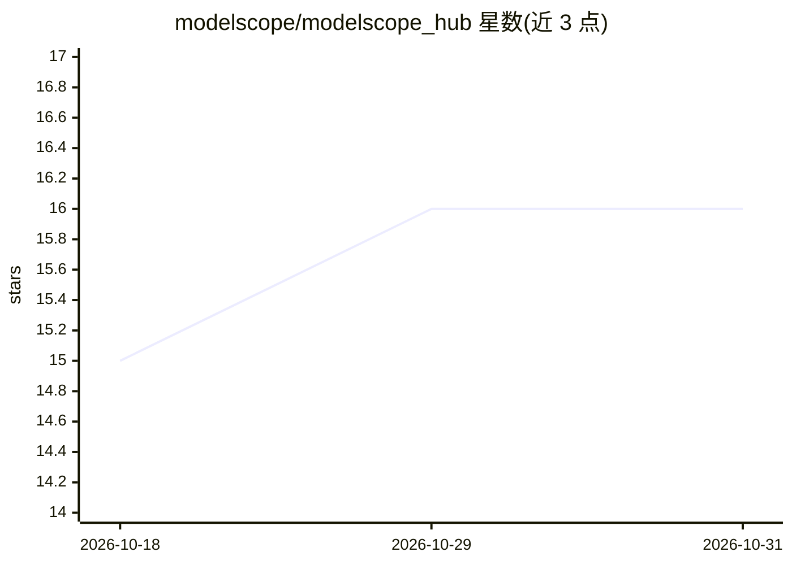

# modelscope/modelscope_hub

⭐ 16 · Python · Apache-2.0 · 推送 2026-10-30 · [GitHub](https://github.com/modelscope/modelscope_hub) · 组织维护 · 中文 README

**ModelScope Hub 官方 Python SDK 与 CLI，管理模型/数据集等 AI 资产**

ModelScope 官方的 Python 客户端：通过单一 HubApi 类或 ms-hub 命令行访问 ModelScope Hub 上的模型、数据集、Studio spaces、技能与 MCP 服务器，覆盖下载、上传、部署、密钥管理与缓存检查。下载路径支持 HTTP Range 断点续传、并行分片、重试与 SHA256 校验。面向在 ModelScope 生态中获取和管理 AI 资产的开发者，需 Python 3.10+，依赖仅 requests/tqdm/filelock/urllib3。

## 筛选速览

| 维度 | 判定 | 备注 |
|---|---|---|
| AI 角色 | `ai-ecosystem` | LLM/agent 周边工具 |
| 许可风险 | `permissive` | Apache-2.0 |
| 部署形态 | `library` | 以包/库形式分发 |
| 模型依赖 | — | README 未给出锁定关系 |
| 硬件要求 | — | 无带数字的原话,不猜 |
| 安装摩擦 | `medium` | 含编译或系统依赖之一 |
| 成熟度 | — | 结构信号不足 |

## 能力要点

- 统一仓库接口覆盖模型、数据集、Studio、技能与 MCP 服务器
- 下载支持断点续传、并行分片、重试退避与 SHA256 校验
- 提供四个等价命令行入口（modelscope/ms/modelscope-hub/ms-hub）
- download_repo_report 返回 COMPLETE/PARTIAL 迁移报告，可跳过单文件失败

## 适用场景

- 从 ModelScope Hub 下载模型和数据集到本地
- 用脚本或 CLI 上传、管理自己的模型仓库
- 在数据迁移任务中获得容错的批量下载报告

## 场景标签

 · 领域:AI 资产管理/模型仓库客户端

## 证据(README 行号)

> L1: The official Python SDK & CLI for ModelScope Hub — download, upload, and manage AI assets from one unified interface
> L14: `modelscope-hub` connects your code to the ModelScope ecosystem — models, datasets, Studio spaces, skills, and MCP 

## 星数曲线

2026-10-18 15 → 2026-10-31 16（+1）

---
*卡片 v1 · prompt 1.4 · 生成 2026-10-30 · 置信度 high · 依据 README sha `2c4f21ff9b2c` · [字段定义](../../DATASET.md)*
