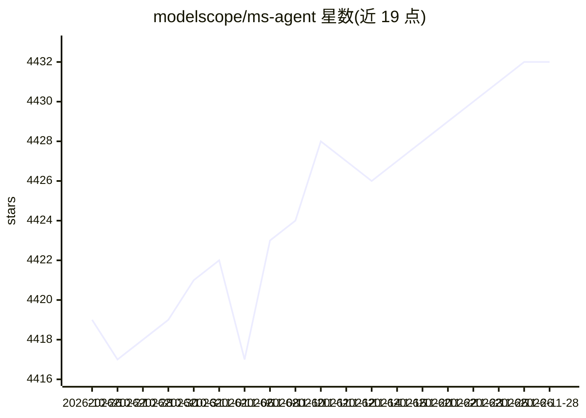

# modelscope/ms-agent

⭐ 4,432 · Python · Apache-2.0 · 推送 2026-11-26 · [GitHub](https://github.com/modelscope/ms-agent) · [官网](https://ms-agent-en.readthedocs.io) · 组织维护 · 中文 README

**面向开发者的轻量级 Agent 框架，编排模型/工具/子智能体执行长任务**

由 ModelScope 团队发布的模块化开源 Agent 框架，用于构建执行复杂、长时间运行任务的智能体：通过可定制 harness 管理规划、上下文、权限与执行反馈，支持项目记忆与自动调度。CLI、TUI、WebUI 共享同一 Python SDK 运行时；支持 MCP 工具接入、技能系统（兼容 Anthropic Agent Skills 协议）、深度研究工作流（Agentic Insight/FinResearch）、多模态输入及上下文压缩与分层记忆架构。

## 筛选速览

| 维度 | 判定 | 备注 |
|---|---|---|
| AI 角色 | `ai-ecosystem` | LLM/agent 周边工具 |
| 许可风险 | `permissive` | Apache-2.0 |
| 部署形态 | `self-host` | docker 或自建部署 |
| 模型依赖 | — | README 未给出锁定关系 |
| 硬件要求 | — | 无带数字的原话,不猜 |
| 安装摩擦 | `low` | 无编译、无系统依赖或容器化 |
| 成熟度 | — | 结构信号不足 |

## 能力要点

- CLI/TUI/WebUI 共享统一 Python SDK 运行时
- 多层级上下文与记忆架构，支持上下文压缩与跨会话持久记忆
- 支持 MCP 协议及 Anthropic Agent Skills 协议实现
- 内置深度研究工作流 Agentic Insight 与金融研究 FinResearch

## 适用场景

- 构建执行深度研究并生成报告的智能体
- 开发复杂代码生成任务的工作流
- 通过 MCP 接入工具构建可长期运行的生产力助手

## 场景标签

`Agent 框架` `多智能体` · 领域:Agent 开发

## 证据(README 行号)

> L17: **MS-Agent is a modular, extensible open-source agent framework built for complex, long-running tasks.** Combine mo
> L19: A shared Python SDK handles execution and management for the **CLI, TUI, and WebUI**, so you can reuse agent logic 
> L129: One shared Python SDK runtime powers the **browser WebUI (`ms-agent ui`), native terminal TUI (`ms-agent`), CLI, a

## 星数曲线

2026-10-26 4,419 → 2026-11-28 4,432（+13）

---
*卡片 v1 · prompt 1.4 · 生成 2026-11-27 · 置信度 mid · 依据 README sha `e701aa8655e9` · [字段定义](../../DATASET.md)*
