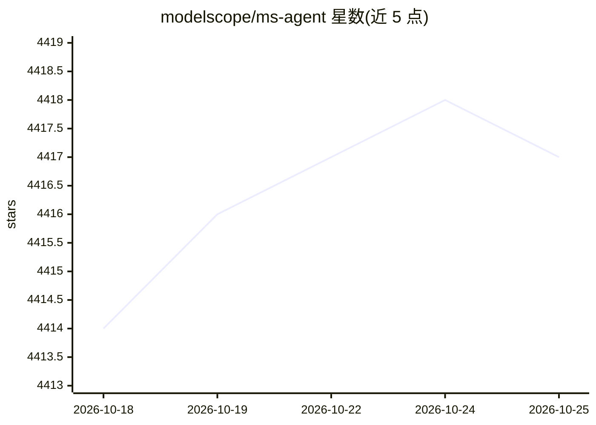

# modelscope/ms-agent

⭐ 4,419 · Python · Apache-2.0 · 推送 2026-10-19 · [GitHub](https://github.com/modelscope/ms-agent) · [官网](https://ms-agent-en.readthedocs.io) · 组织维护 · 中文 README

**面向复杂长时任务的模块化开源 agent 框架**

ModelScope 团队维护的 Python agent 框架：以可定制的 harness 组织规划、上下文、权限与执行反馈，组合模型、工具、技能与子代理构建生产力助手；分层管理会话历史、活动上下文与项目记忆，支持 Cron 调度、上下文压缩、多模型接入、MCP 工具与 ACP/A2A 集成。同一 SDK 覆盖 WebUI、TUI、CLI 三种界面。内置 DeepResearch（Agentic Insight）、FinResearch 金融研究、Code Genesis、Singularity Cinema 视频生成等应用。默认使用 ModelScope 提供方，需申请 API token。

## 筛选速览

| 维度 | 判定 | 备注 |
|---|---|---|
| AI 角色 | `ai-ecosystem` | LLM/agent 周边工具 |
| 许可风险 | `permissive` | Apache-2.0 |
| 部署形态 | `library` | 以包/库形式分发 |
| 模型依赖 | — | README 未给出锁定关系 |
| 硬件要求 | — | 无带数字的原话,不猜 |
| 安装摩擦 | `low` | 无编译、无系统依赖或容器化 |
| 成熟度 | — | 结构信号不足 |

## 能力要点

- 可定制 harness 管理规划、上下文、权限与执行反馈
- 分层记忆（会话历史/活动上下文/项目记忆）与 Cron 自主调度
- 多模型接入、MCP 工具、ACP/A2A 集成与 Agent Hub 跨框架资源转换
- 内置 Agentic Insight 深度研究、FinResearch 金融分析、Code Genesis 等应用

## 适用场景

- 构建执行复杂长时任务的个人生产力助手
- 搭建深度研究、金融分析等多代理工作流
- 在终端、浏览器或 Python 应用中复用同一套 agent 逻辑

## 场景标签

`Agent 框架` `金融量化` `科研工具` · 领域:Agent 开发

## 证据(README 行号)

> L17: **MS-Agent is a modular, extensible open-source agent framework built for complex, long-running tasks.** Combine mo
> L19: A shared Python SDK handles execution and management for the **CLI, TUI, and WebUI**, so you can reuse agent logic 
> L138: Connect to multiple model providers, use MCP for external tools, integrate with editors and other agents through A

## 星数曲线

2026-10-18 4,414 → 2026-10-25 4,417（+3）

---
*卡片 v1 · prompt 1.4 · 生成 2026-10-20 · 置信度 mid · 依据 README sha `d56e6afef923` · [字段定义](../../DATASET.md)*
