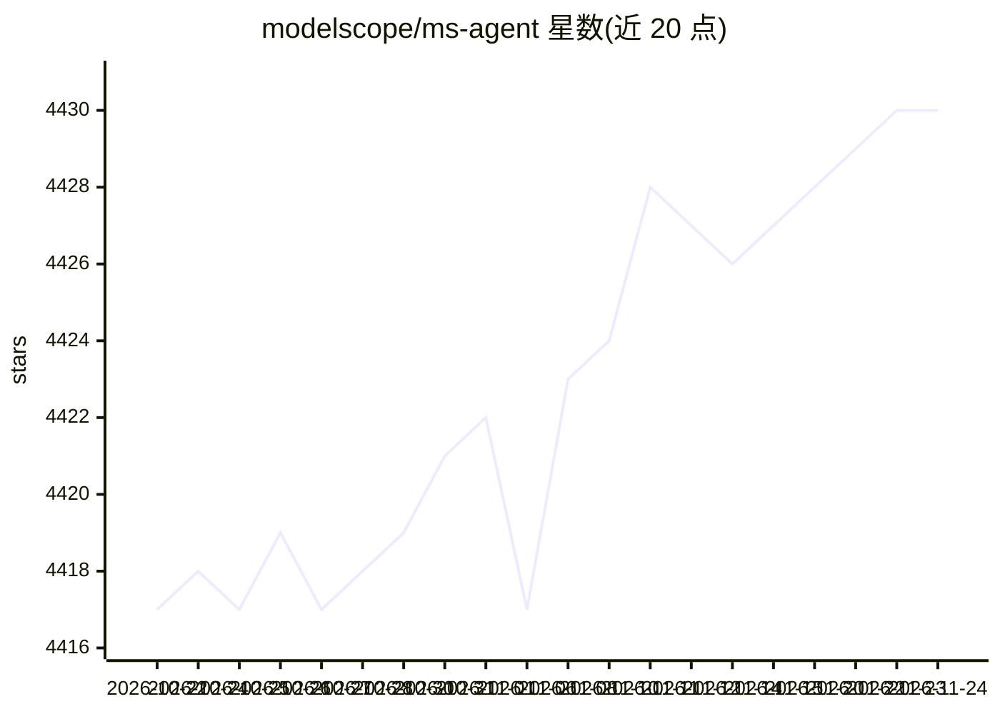

# modelscope/ms-agent

⭐ 4,431 · Python · Apache-2.0 · 推送 2026-11-23 · [GitHub](https://github.com/modelscope/ms-agent) · [官网](https://ms-agent-en.readthedocs.io) · 组织维护 · 中文 README

**面向复杂长任务的模块化开源 agent 框架**

MS-Agent 是 ModelScope 团队维护的模块化、可扩展 agent 框架，用于构建执行复杂长任务的助手。核心机制包括：可定制的 agent harness（工具执行、权限检查、生命周期回调）、分层上下文与项目记忆、cron 定时任务、主 agent 向专家子 agent 委派或 DAG/顺序工作流、技能打包与评估驱动的技能演化。提供 CLI、TUI、WebUI 与 Python SDK 四种接口，共享同一套执行 SDK。内置深度研究（Agentic Insight/DeepResearch）、代码生成、金融研究等应用，支持 MCP 工具与 ACP/A2A 集成。

## 筛选速览

| 维度 | 判定 | 备注 |
|---|---|---|
| AI 角色 | `ai-ecosystem` | LLM/agent 周边工具 |
| 许可风险 | `permissive` | Apache-2.0 |
| 部署形态 | `library` | 以包/库形式分发 |
| 模型依赖 | — | README 未给出锁定关系 |
| 硬件要求 | — | 无带数字的原话,不猜 |
| 安装摩擦 | `low` | 无编译、无系统依赖或容器化 |
| 成熟度 | — | 结构信号不足 |

## 能力要点

- 可定制 harness：工具执行、权限检查、生命周期回调与 Hooks
- 分层上下文与项目记忆，支持 cron 定时任务与上下文压缩
- 多 agent 协作：子 agent 委派、顺序工作流与 DAG 编排
- WebUI/TUI/CLI/Python SDK 四种接口共享同一 Python SDK

## 适用场景

- 构建执行复杂长任务的个人生产力助手
- 金融研究、深度研究报告等多 agent 工作流
- 在终端或浏览器中管理 agent 会话与技能
- 将 agent 能力嵌入自有 Python 应用

## 场景标签

`Agent 框架` `多智能体` · 领域:Agent 开发

## 证据(README 行号)

> L17: **MS-Agent is a modular, extensible open-source agent framework built for complex, long-running tasks.** Combine mo
> L19: A shared Python SDK handles execution and management for the **CLI, TUI, and WebUI**, so you can reuse agent logic 
> L138: Connect to multiple model providers, use MCP for external tools, integrate with editors and other agents through A

## 星数曲线

2026-10-22 4,417 → 2026-11-24 4,430（+13）

---
*卡片 v1 · prompt 1.4 · 生成 2026-11-22 · 置信度 high · 依据 README sha `0d3b0225bbab` · [字段定义](../../DATASET.md)*
