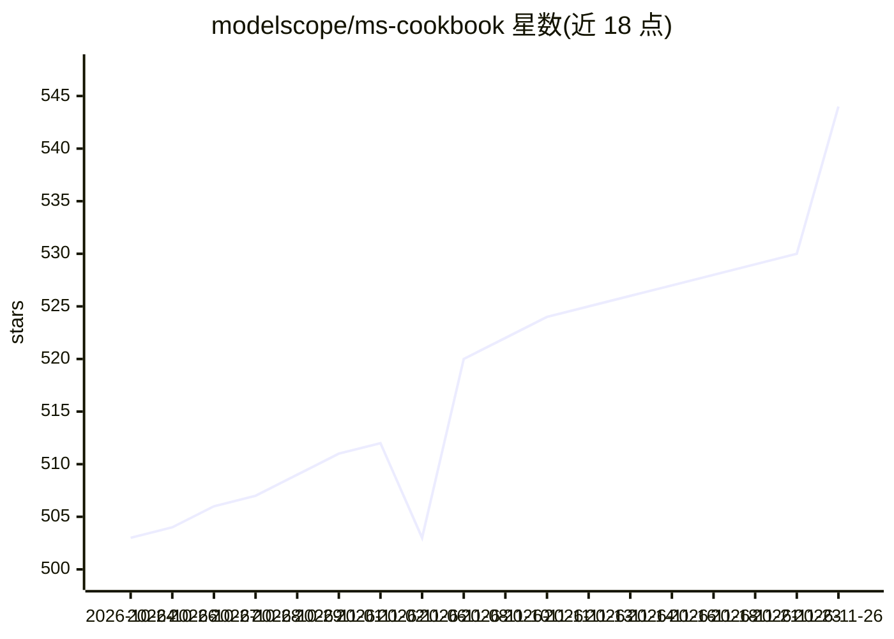

# modelscope/ms-cookbook

⭐ 544 · HTML · Apache-2.0 · 推送 2026-11-25 · [GitHub](https://github.com/modelscope/ms-cookbook) · [官网](https://modelscope.cn/active/ms-cookbook) · 组织维护 · 中文 README

**面向开发者的开源模型应用实战教程（8 篇 41 章）**

魔搭社区出品的开源模型应用教程书籍与配套阅读网站，按 8 篇主题、41 个章节组织学习路线，覆盖模型选型、推理部署、量化、微调（ms-swift）、评测（EvalScope）、RAG、Agent 与 AIGC 案例。结合 EvalScope、ms-swift、DiffSynth、Ollama 等工具展开实践；提供在线阅读入口与本地 git clone 后用 Python http.server 起站的阅读方式，支持社区共建案例、勘误与英文翻译。要求读者具备基础 Python 与命令行知识。

## 筛选速览

| 维度 | 判定 | 备注 |
|---|---|---|
| AI 角色 | `ai-knowledge` | 知识聚合/清单类 |
| 许可风险 | `permissive` | Apache-2.0 |
| 部署形态 | `None` |  |
| 模型依赖 | local-ok | 支持本地模型 |
| 硬件要求 | — | 无带数字的原话,不猜 |
| 安装摩擦 | `low` | 无编译、无系统依赖或容器化 |
| 成熟度 | — | 结构信号不足 |

## 能力要点

- 8 篇主题、41 个章节的模型应用学习路线
- 含 RAG、语音助手、手机巡检、AIGC、Agent 等可复现案例
- 使用 EvalScope 评测选型、ms-swift 微调、DiffSynth 训练图像 LoRA
- 支持场景案例共建与英文翻译共建

## 适用场景

- 系统学习开源模型从选型、推理到微调评测的完整流程
- 为业务场景查找可复现的模型应用案例
- 入门 Agent、MCP 与工具调用开发
- 学习图像 LoRA 定制与商品图、海报生成流程

## 场景标签

`教程课程` `RAG` `微调` `模型评测` · 领域:评测与运维

## 证据(README 行号)

> L26: **魔搭紫皮书是面向开发者的开源模型应用实战指南。** 我们从这些具体问题出发，把模型选型、推理部署、数据准备、微调评测与应用开发串成一条学习路线，并通过 RAG、Agent、AIGC 和端侧应用等案例，带你把方法用起来。
> L86: 全书按 **8 篇主题、41 个章节**组织，覆盖从认识模型到场景应用的学习过程。点击章节可在 GitHub 阅读正文，也可前往在线阅读网站。

## 星数曲线

2026-10-24 503 → 2026-11-26 544（+41）

---
*卡片 v1 · prompt 1.4 · 生成 2026-11-26 · 置信度 high · 依据 README sha `f1795b6bdeda` · [字段定义](../../DATASET.md)*
