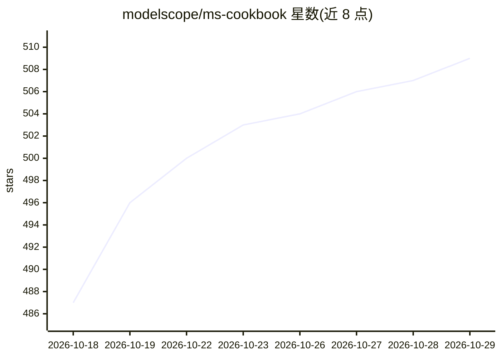

# modelscope/ms-cookbook

⭐ 509 · HTML · Apache-2.0 · 推送 2026-10-22 · [GitHub](https://github.com/modelscope/ms-cookbook) · [官网](https://modelscope.cn/active/ms-cookbook) · 组织维护 · 中文 README

**开源模型应用实战指南（魔搭紫皮书）：38 章覆盖选型到落地**

ModelScope 团队维护的开源教程书（魔搭紫皮书），面向开发者和学生讲解开源 AI 模型的实际应用：8 个部分 38 章，覆盖模型选型、推理部署、数据准备、微调（ms-swift）、评测（EvalScope）、RAG、Agent 与 AIGC（DiffSynth）。各章配可运行示例，如企业知识问答、语音助手、客服质检、产线巡检 Agent。支持在线阅读，也可 git clone 后本地起 HTTP 服务阅读；本地阅读仅需 Python 3 与浏览器，无构建依赖。

## 筛选速览

| 维度 | 判定 | 备注 |
|---|---|---|
| AI 角色 | `ai-knowledge` | 知识聚合/清单类 |
| 许可风险 | `permissive` | Apache-2.0 |
| 部署形态 | `None` |  |
| 模型依赖 | — | README 未给出锁定关系 |
| 硬件要求 | — | 无带数字的原话,不猜 |
| 安装摩擦 | `low` | 无编译、无系统依赖或容器化 |
| 成熟度 | — | 结构信号不足 |

## 能力要点

- 8 部分 38 章结构化学习路径，含可运行示例
- 配套工具链：EvalScope 评测、ms-swift 微调、DiffSynth 图像 LoRA、Ollama 本地推理
- 本地阅读零依赖：Python 3 + 浏览器即可，无需 API key 或 GPU
- 应用示例覆盖知识问答、语音助手、巡检 Agent、商品图生成等场景

## 适用场景

- 系统学习从模型选型、推理到微调评测的完整流程
- 照章节示例搭建企业知识问答或语音助手应用
- 为 AIGC 图像定制（LoRA 训练、商品图生成）找实操路径

## 场景标签

`教程课程` · 领域:学习与行业

## 证据(README 行号)

> L23: **ModelScope Cookbook is a hands-on, open-source guide to using open-source AI models in real applications.** It br
> L29: > **8 parts · 38 chapters · 37 available to read**

## 星数曲线

2026-10-18 487 → 2026-10-29 509（+22）

---
*卡片 v1 · prompt 1.4 · 生成 2026-10-21 · 置信度 high · 依据 README sha `27b07c2f4c0c` · [字段定义](../../DATASET.md)*
