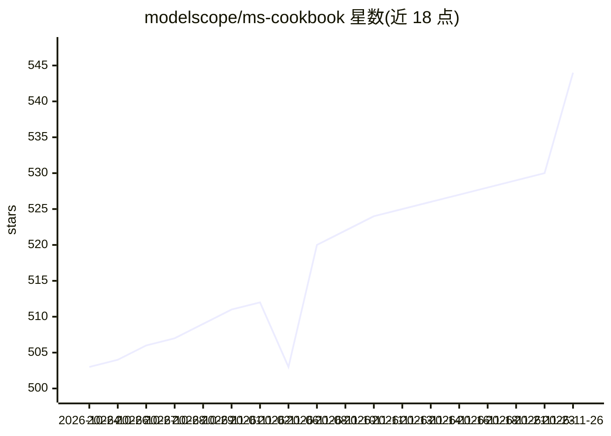

# modelscope/ms-cookbook

⭐ 544 · HTML · Apache-2.0 · 推送 2026-11-25 · [GitHub](https://github.com/modelscope/ms-cookbook) · [官网](https://modelscope.cn/active/ms-cookbook) · 组织维护 · 中文 README

**面向开发者的开源模型应用实战教程书（8篇40章）**

魔搭社区维护的开源模型应用实战指南，以教程/章节形式组织为 8 篇 40 章，内容覆盖模型选型、推理部署、数据准备、微调评测、RAG、Agent 与 AIGC 案例。配套在线阅读网站（支持搜索、导航、代码复制），也可克隆仓库后用 Python 3 内置 HTTP 服务本地阅读。书中实践结合 EvalScope、ms-swift、DiffSynth、Ollama 等工具，各章节需按说明自行准备依赖、模型文件与算力。章节含共建征集入口，部分章节标记待更新。

## 筛选速览

| 维度 | 判定 | 备注 |
|---|---|---|
| AI 角色 | `ai-knowledge` | 知识聚合/清单类 |
| 许可风险 | `permissive` | Apache-2.0 |
| 部署形态 | `None` |  |
| 模型依赖 | local-ok | 支持本地模型 |
| 硬件要求 | — | 无带数字的原话,不猜 |
| 安装摩擦 | `low` | 无编译、无系统依赖或容器化 |
| 成熟度 | — | 结构信号不足 |

## 能力要点

- 8 篇主题 40 章的学习路线，含选型/推理/微调/评测/应用章节
- 真实任务库：健身教练、客服质检、语音助手、知识问答、手机巡检等 10 个案例
- 结合 EvalScope、ms-swift、DiffSynth、Ollama 等工具开展实践
- 支持在线阅读或 git clone 后本地 HTTP 服务阅读

## 适用场景

- 按学习路线从首次模型推理走到微调与评测
- 照着章节案例搭建企业知识问答或语音助手应用
- 参考 AIGC 章节实践图像 LoRA 定制与海报生成

## 场景标签

`教程课程` · 领域:学习与行业

## 证据(README 行号)

> L26: **魔搭紫皮书是面向开发者的开源模型应用实战指南。** 我们从这些具体问题出发，把模型选型、推理部署、数据准备、微调评测与应用开发串成一条学习路线，并通过 RAG、Agent、AIGC 和端侧应用等案例，带你把方法用起来。
> L86: 全书按 **8 篇主题、40 个章节**组织，覆盖从认识模型到场景应用的学习过程。点击章节可在 GitHub 阅读正文，也可前往在线阅读网站。
> L90: |章节|关键内容|状态|

## 星数曲线

2026-10-24 503 → 2026-11-26 544（+41）

---
*卡片 v1 · prompt 1.4 · 生成 2026-11-25 · 置信度 high · 依据 README sha `282977410e42` · [字段定义](../../DATASET.md)*
