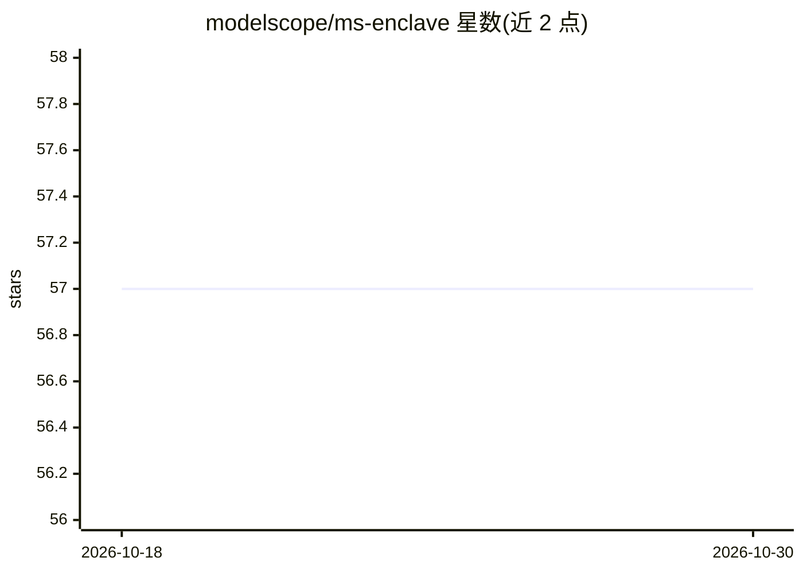

# modelscope/ms-enclave

⭐ 57 · Python · Apache-2.0 · 推送 2026-09-17 · [GitHub](https://github.com/modelscope/ms-enclave) · 组织维护 · 中文 README

**Agent 沙箱运行时：为代码执行提供 Docker 隔离环境**

基于 Docker 容器的模块化沙箱运行时库，为应用提供隔离执行环境：内置 DOCKER 与 DOCKER_NOTEBOOK 两类沙箱，支持 python/shell/文件操作及多语言代码执行等工具（OpenAI 风格 schema，可交给模型触发调用）。提供 SandboxFactory、本地/HTTP 两种管理器、预热沙箱池三种用法，支持内存/CPU 限额、卷挂载、端口映射等配置，内置 FastAPI 服务支持跨机远程管理。工具须在 tools_config 显式声明才会注册。面向需要安全执行不可信代码的 AI 应用开发者。

## 筛选速览

| 维度 | 判定 | 备注 |
|---|---|---|
| AI 角色 | `ai-ecosystem` | LLM/agent 周边工具 |
| 许可风险 | `permissive` | Apache-2.0 |
| 部署形态 | `library` | 以包/库形式分发 |
| 模型依赖 | — | README 未给出锁定关系 |
| 硬件要求 | — | 无带数字的原话,不猜 |
| 安装摩擦 | `low` | 无编译、无系统依赖或容器化 |
| 成熟度 | — | 结构信号不足 |

## 能力要点

- Docker 容器隔离执行，可配置内存/CPU 限额、卷挂载、网络开关
- 沙箱工具以 OpenAI Tools 格式暴露，可由模型 tool_calls 触发执行
- 本地/HTTP 双管理器与预热沙箱池（FIFO 借还、超时排队）
- multi_code_executor 支持 20+ 种语言，需指定镜像

## 适用场景

- 让 Agent 在隔离容器中安全执行 Python/Shell 代码
- 跨机器部署集中管理的代码执行服务
- 通过沙箱池摊平容器启动开销，支撑高并发执行任务

## 场景标签

`Agent 框架` · 领域:Agent 开发

## 证据(README 行号)

> L12: ms-enclave is a modular and stable sandbox runtime environment that provides a secure isolated execution environmen
> L57: ## Agent Model Tool Calling (OpenAI Tools)
> L59: Expose sandbox tools to the Agent in OpenAI Tools format, allowing the model to trigger tools and execute them secu

## 星数曲线

2026-10-18 57 → 2026-10-30 57（+0）

---
*卡片 v1 · prompt 1.4 · 生成 2026-10-24 · 置信度 high · 依据 README sha `20c209f42720` · [字段定义](../../DATASET.md)*
