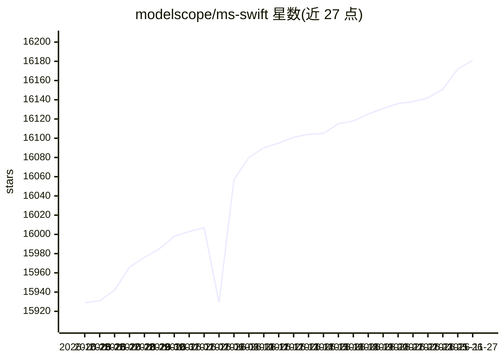

# modelscope/ms-swift

⭐ 16,181 · Python · Apache-2.0 · 推送 2026-11-26 · [GitHub](https://github.com/modelscope/ms-swift) · [官网](https://swift.readthedocs.io/zh-cn/latest/) · 组织维护 · 中文 README

**大模型与多模态模型的微调、推理、评测、量化与部署框架**

ModelScope 社区提供的大模型与多模态大模型微调与部署框架，覆盖训练（预训练、微调、人类对齐）、推理、评测、量化与部署全流程，支持 600+ 纯文本模型与 400+ 多模态模型。内置 150+ 数据集，集成 Megatron 并行策略与 GRPO 系列强化学习算法，支持 LoRA/QLoRA 等轻量微调方法，可借助 vLLM/SGLang/LMDeploy 加速推理，并提供 Web-UI 界面。以 pip 或源码方式安装，要求 Python >=3.10。

## 筛选速览

| 维度 | 判定 | 备注 |
|---|---|---|
| AI 角色 | `ai-ecosystem` | LLM/agent 周边工具 |
| 许可风险 | `permissive` | Apache-2.0 |
| 部署形态 | `library` | 以包/库形式分发 |
| 模型依赖 | local-ok | 支持本地模型 |
| 硬件要求 | — | 无带数字的原话,不猜 |
| 安装摩擦 | `medium` | 含编译或系统依赖之一 |
| 成熟度 | — | 结构信号不足 |

## 动量与使用信号

- 维护:`active` — 距上次 push 1.9 天,年发版 42,235 位贡献者
- 涨星:近 1 天 **+9**(自 20261016 起算)
- 安装:pypi 包 `ms-swift` 月下载 49,651

## 能力要点

- 支持 600+ 文本模型与 400+ 多模态模型的训练到部署全流程
- 集成 Megatron 并行（TP/PP/CP/EP）与 GRPO/DAPO/GSPO 等强化学习算法
- 支持 LoRA、QLoRA、DoRA 等轻量微调，7B 量化模型训练仅需 9GB 资源
- 提供 Web-UI 完成训练、推理、评测与量化

## 适用场景

- 对开源大模型做 SFT/DPO/GRPO 微调训练
- 训练多模态模型（图文/视频/音频混合数据）
- 用量化技术降低显存后进行本地训练与部署
- 通过 EvalScope 后端批量评测模型

## 场景标签

`微调` `模型训练` `强化学习` `模型量化` · 领域:训练与推理

## 证据(README 行号)

> L23: 🍲 **ms-swift** is a large model and multimodal large model fine-tuning and deployment framework provided by the Mod
> L41: - **Full-Pipeline Capabilities**: Covers the entire workflow of training, inference, evaluation, quantization, and 
> L43: - **Inference Acceleration**: Supports Transformers, vLLM, SGLang, and LmDeploy inference acceleration engines, pro

## 星数曲线

2026-10-25 15,929 → 2026-11-27 16,181（+252）

---
*卡片 v1 · prompt 1.4 · 生成 2026-11-22 · 置信度 high · 依据 README sha `ede0e7812aa7` · [字段定义](../../DATASET.md)*
