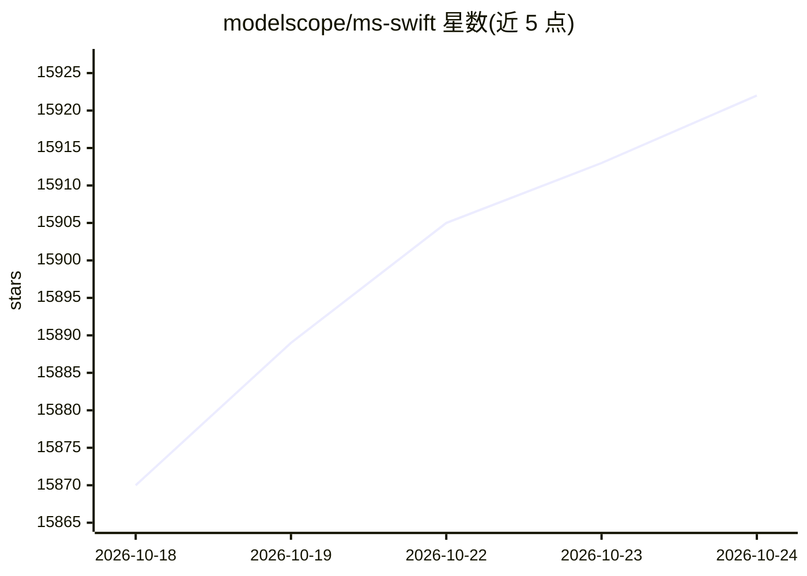

# modelscope/ms-swift

⭐ 15,922 · Python · Apache-2.0 · 推送 2026-10-23 · [GitHub](https://github.com/modelscope/ms-swift) · [官网](https://swift.readthedocs.io/zh-cn/latest/) · 组织维护 · 中文 README

**面向开发者的 LLM/MLLM 微调、推理、评测与部署训练框架**

ModelScope 社区提供的大模型与多模态大模型训练部署框架，覆盖预训练、指令微调、人类偏好对齐（DPO/KTO/ORPO 等）、GRPO 系列强化学习及 Embedding/Reranker 训练，支持 600+ 文本模型与 400+ 多模态模型。提供 LoRA/QLoRA 等轻量微调、量化训练、Megatron 并行（TP/PP/CP/EP）、DeepSpeed/FSDP 分布式，并可配合 vLLM/SGLang/LMDeploy 做推理加速部署。含 Web-UI 与 CLI，内置 150+ 数据集；硬件支持 NVIDIA/AMD GPU、昇腾 NPU、Apple MPS 与 CPU。论文被 AAAI 2025 接收。

## 筛选速览

| 维度 | 判定 | 备注 |
|---|---|---|
| AI 角色 | `ai-ecosystem` | LLM/agent 周边工具 |
| 许可风险 | `permissive` | Apache-2.0 |
| 部署形态 | `library` | 以包/库形式分发 |
| 模型依赖 | local-ok | 支持本地模型 |
| 硬件要求 | — | 无带数字的原话,不猜 |
| 安装摩擦 | `medium` | 含编译或系统依赖之一 |
| 成熟度 | — | 结构信号不足 |

## 动量与使用信号

- 维护:`active` — 距上次 push 1.9 天,年发版 42,235 位贡献者
- 涨星:近 1 天 **+9**(自 20261016 起算)
- 安装:pypi 包 `ms-swift` 月下载 49,651

## 能力要点

- 600+ 文本模型与 400+ 多模态模型的训练到部署全流程支持
- LoRA/QLoRA 等轻量微调与 BNB/GPTQ/AWQ 量化训练（7B 模型最低 9GB 资源）
- GRPO 家族强化学习算法（GRPO/DAPO/GSPO/CISPO 等）与 Megatron 并行策略
- 内置 150+ 数据集与 Web-UI，支持 vLLM/SGLang/LMDeploy 推理加速与 EvalScope 评测

## 适用场景

- 在单卡 3090 上用 LoRA 快速微调 Qwen 等开源模型
- 多 GPU/多机环境下用 Megatron 并行做 MoE 大模型全参数训练
- 用 GRPO 系列算法做模型强化学习训练
- 训练后直接量化导出并配合 vLLM 部署推理服务

## 场景标签

`微调` `模型训练` `强化学习` `推理引擎` · 领域:训练与推理

## 证据(README 行号)

> L23: 🍲 **ms-swift** is a large model and multimodal large model fine-tuning and deployment framework provided by the Mod
> L25: 🍔 In addition, ms-swift integrates the latest training technologies, including Megatron parallelism techniques such

## 星数曲线

2026-10-18 15,870 → 2026-10-24 15,922（+52）

---
*卡片 v1 · prompt 1.4 · 生成 2026-10-20 · 置信度 high · 依据 README sha `99529d64652f` · [字段定义](../../DATASET.md)*
