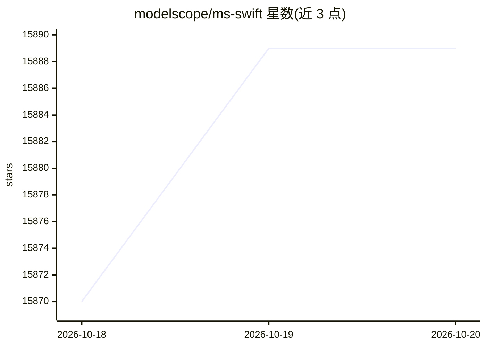

# modelscope/ms-swift

⭐ 15,889 · Python · Apache-2.0 · 推送 2026-10-19 · [GitHub](https://github.com/modelscope/ms-swift) · [官网](https://swift.readthedocs.io/zh-cn/latest/) · 组织维护 · 中文 README

**给开发者微调与部署 600+ LLM/400+ MLLM 的训练框架**

ModelScope 社区提供的大模型与多模态大模型微调及部署框架，覆盖预训练、微调、人类对齐训练、推理、评测、量化和部署全流程。集成 Megatron 并行（TP/PP/CP/EP）加速训练，内置 GRPO 系列强化学习算法（GRPO、DAPO、GSPO 等）与 DPO/KTO/SimPO 等偏好学习算法，支持 Embedding/Reranker 训练。通过 vLLM/SGLang/LMDeploy 加速推理，AWQ/GPTQ/BNB/FP8 量化。提供 Web-UI 界面，内置 150+ 数据集，支持自定义数据集一键训练。

## 筛选速览

| 维度 | 判定 | 备注 |
|---|---|---|
| AI 角色 | `ai-ecosystem` | LLM/agent 周边工具 |
| 许可风险 | `permissive` | Apache-2.0 |
| 部署形态 | `library` | 以包/库形式分发 |
| 模型依赖 | local-ok | 支持本地模型 |
| 硬件要求 | — | 无带数字的原话,不猜 |
| 安装摩擦 | `medium` | 含编译或系统依赖之一 |
| 成熟度 | — | 结构信号不足 |

## 动量与使用信号

- 维护:`active` — 距上次 push 1.9 天,年发版 42,235 位贡献者
- 涨星:近 1 天 **+9**(自 20261016 起算)
- 安装:pypi 包 `ms-swift` 月下载 49,651

## 能力要点

- 支持 600+ 纯文本与 400+ 多模态大模型的训练到部署全流程
- 内置 GRPO/DAPO/GSPO 等强化学习算法与 DPO/KTO 等偏好学习算法
- 支持 LoRA/QLoRA/DoRA 等轻量微调与 Megatron/DeepSpeed/FSDP 分布式训练
- 支持量化模型训练，7B 模型仅需 9GB 训练资源

## 适用场景

- 用 LoRA 或全参数方式微调 Qwen、Llama 等开源模型
- 对多模态模型做图文音视频混合数据训练
- 用 GRPO 算法对模型做强化学习对齐
- 训练后量化导出并用 vLLM 部署推理服务

## 场景标签

`微调` `模型训练` `强化学习` `模型量化` · 领域:训练与推理

## 证据(README 行号)

> L23: 🍲 **ms-swift** is a large model and multimodal large model fine-tuning and deployment framework provided by the Mod
> L31: - **Hardware Support**: Supports NVIDIA GPUs (A100/H100/RTX series, etc., via CUDA), AMD GPUs (MI300 series, etc., 
> L90: To install using pip:

## 星数曲线

2026-10-18 15,870 → 2026-10-20 15,889（+19）

---
*卡片 v1 · prompt 1.4 · 生成 2026-10-18 · 置信度 high · 依据 README sha `d7e868defd77` · [字段定义](../../DATASET.md)*
