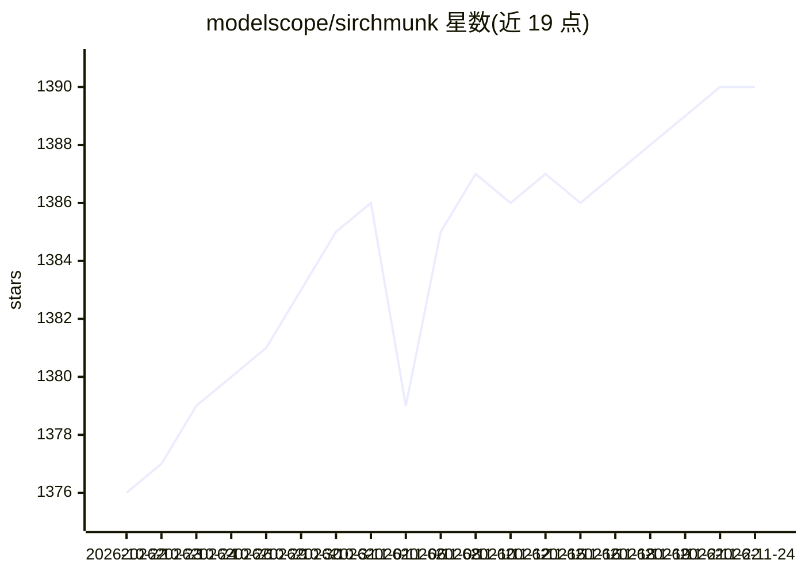

# modelscope/sirchmunk

⭐ 1,391 · Python · Apache-2.0 · 推送 2026-10-23 · [GitHub](https://github.com/modelscope/sirchmunk) · [官网](https://modelscope.github.io/sirchmunk-web/) · 组织维护 · 中文 README

**面向 AI Agent 的免索引实时智能检索服务**

Sirchmunk 以原始数据为检索对象，无需向量化与索引即可对本地与网络文件进行搜索，提供 Python API、CLI、HTTP API、MCP Server 与 Web UI 多种接入方式。检索框架 LENS 在 token 预算约束下迭代定位证据，回答附带来源链接与遥测信息；知识图谱随使用自动演化，支持多轮对话与数值确定性校验。提供 Docker 镜像部署与 OpenClaw 技能集成。

## 筛选速览

| 维度 | 判定 | 备注 |
|---|---|---|
| AI 角色 | `ai-native` | 本体是模型或模型工具 |
| 许可风险 | `permissive` | Apache-2.0 |
| 部署形态 | `self-host` | docker 或自建部署 |
| 模型依赖 | local-ok | 支持本地模型 |
| 硬件要求 | — | 无带数字的原话,不猜 |
| 安装摩擦 | `low` | 无编译、无系统依赖或容器化 |
| 成熟度 | — | 结构信号不足 |

## 能力要点

- 免索引检索：直接对原始文件搜索，支持 LOG/PPTX/XLSX/DOCX 等格式
- LENS 预算约束检索框架，含多路召回与 RRF 融合
- KnowledgeEvolver 四阶段知识图谱自演化与 Web UI 可视化
- 多形态接入：Python API/CLI/HTTP API/MCP Server/Web UI

## 适用场景

- 让本地 Agent 通过 MCP 或 OpenClaw 技能以自然语言搜索本地文件
- 对频繁变化的大量文档做即时问答而无需预先建索引
- 搭建带来源引用的多轮 RAG 对话服务

## 场景标签

`RAG` `知识图谱` · 领域:知识与检索

## 证据(README 行号)

> L22: 🔍 **Agentic Search** &nbsp;•&nbsp; 🧠 **Knowledge Clustering** &nbsp;•&nbsp; 📊 **Budgeted Evidence Exploration**
> L45: * **LLM-Powered Autonomy:** Designed for Agents that perceive data as it lives, utilizing **token-efficient** reaso
> L118:  - **DEEP by default**: Default search mode switched from FAST to DEEP across the Python API, CLI, HTTP API, MCP s

## 星数曲线

2026-10-22 1,376 → 2026-11-24 1,390（+14）

---
*卡片 v1 · prompt 1.4 · 生成 2026-11-23 · 置信度 high · 依据 README sha `c2c67880ef18` · [字段定义](../../DATASET.md)*
