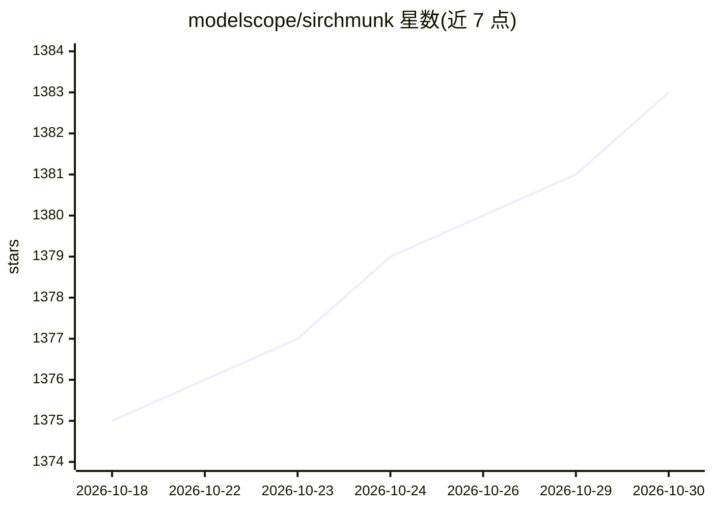

# modelscope/sirchmunk

⭐ 1,383 · Python · Apache-2.0 · 推送 2026-10-23 · [GitHub](https://github.com/modelscope/sirchmunk) · [官网](https://modelscope.github.io/sirchmunk-web/) · 组织维护 · 中文 README

**面向本地海量数据的免向量库实时检索与聊天引擎**

Sirchmunk 提供无需向量数据库的直接检索方案：对原始文件即放即搜（Indexless Retrieval），支持 LENS 预算约束证据导航与 agentic DEEP 多路检索（词法、实体、目录、跨文档主题图，RRF 融合）。知识库随数据与搜索使用自演化（Leiden 社区检测、元簇合成），并按需触发 LLM 推理以控制成本。提供 Python API、CLI、HTTP API、MCP server、Web UI 与 Docker 部署，多轮对话与 OpenAI 多 provider 客户端。限制：README 未列出具体硬件要求与系统依赖细节。

## 筛选速览

| 维度 | 判定 | 备注 |
|---|---|---|
| AI 角色 | `ai-native` | 本体是模型或模型工具 |
| 许可风险 | `permissive` | Apache-2.0 |
| 部署形态 | `self-host` | docker 或自建部署 |
| 模型依赖 | local-ok | 支持本地模型 |
| 硬件要求 | — | 无带数字的原话,不猜 |
| 安装摩擦 | `low` | 无编译、无系统依赖或容器化 |
| 成熟度 | — | 结构信号不足 |

## 能力要点

- 免向量库：直接对原始文件即放即搜
- LENS 预算约束证据导航与多路 DEEP 检索（RRF 融合）
- 知识图谱自演化：Leiden 社区检测 + LLM 元簇合成，后台异步执行
- 提供 Python API/CLI/HTTP/MCP server/Web UI/Docker 多种使用形态

## 适用场景

- 对本地海量文件做自然语言搜索并直接问答
- 通过 MCP server 为 agent 提供本地文件检索能力
- 数据频繁变动的仓库上维持实时可用的知识检索

## 场景标签

`语义搜索` `文档问答` · 领域:知识与检索

## 证据(README 行号)

> L23: ⚡ **Indexless Retrieval** &nbsp;•&nbsp; 🔄 **Self-Evolving Knowledge Base** &nbsp;•&nbsp; 💬 **Real-time Chat**
> L45: * **LLM-Powered Autonomy:** Designed for Agents that perceive data as it lives, utilizing **token-efficient** reaso
> L118:  - **DEEP by default**: Default search mode switched from FAST to DEEP across the Python API, CLI, HTTP API, MCP s

## 星数曲线

2026-10-18 1,375 → 2026-10-30 1,383（+8）

---
*卡片 v1 · prompt 1.4 · 生成 2026-10-21 · 置信度 high · 依据 README sha `8049cf119f95` · [字段定义](../../DATASET.md)*
