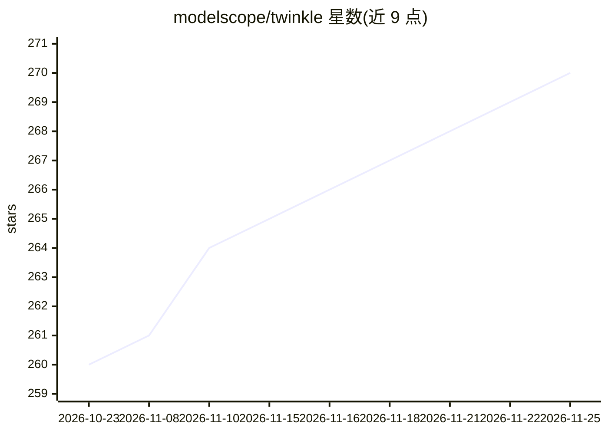

# modelscope/twinkle

⭐ 270 · Python · Apache-2.0 · 推送 2026-11-23 · [GitHub](https://github.com/modelscope/twinkle) · 组织维护 · 中文 README

**轻量级客户端-服务器大模型训练框架，支持本地与 Ray 集群**

由 ModelScope 社区维护的轻量训练框架，将训练逻辑封装为标准化 API，支持 torchrun、Ray、HTTP 三种运行模式和 Transformers/Megatron 双后端。采用客户端-服务器解耦架构，接口向后兼容 Tinker API，可通过 Tinker 客户端或原生客户端访问训练服务，并定位为 TaaS（Training-as-a-Service）后端。支持 LoRA、SFT、DPO、GRPO/PPO RL、GKD 蒸馏等训练类型，多租户共享同一基座模型部署。提供 pip、源码、docker 及一键客户端安装脚本；服务器端支持多租户自动集群管理与动态扩缩。

## 筛选速览

| 维度 | 判定 | 备注 |
|---|---|---|
| AI 角色 | `ai-ecosystem` | LLM/agent 周边工具 |
| 许可风险 | `permissive` | Apache-2.0 |
| 部署形态 | `library` | 以包/库形式分发 |
| 模型依赖 | — | README 未给出锁定关系 |
| 硬件要求 | — | 无带数字的原话,不猜 |
| 安装摩擦 | `low` | 无编译、无系统依赖或容器化 |
| 成熟度 | — | 结构信号不足 |

## 能力要点

- torchrun / Ray / HTTP 多运行模式，Transformers / Megatron 双后端
- 兼容 Tinker API，支持通过 Tinker 客户端或原生客户端接入
- 多租户训练：多个 LoRA 共享一个基座模型部署，租户间隔离
- 支持 Qwen、DeepSeek、GLM、Gemma、InternLM 等模型系列

## 适用场景

- 用 Ray 集群对 Qwen/DeepSeek 等模型做 SFT、LoRA 或 DPO 微调
- 搭建训练即服务（TaaS）后端，多租户并行训练
- 通过 Tinker 客户端调用服务器less 训练服务

## 场景标签

`微调` `强化学习` · 领域:训练与推理

## 证据(README 行号)

> L9: Twinkle✨ is a lightweight, client-server training framework engineered
> L14: abstraction, Twinkle✨ serves as a robust backend and gateway to enable serverless Training-as-a-Service (TaaS).
> L20: 🚀 Multiple Runtime Modes : torchrun / Ray / HTTP.

## 星数曲线

2026-10-23 260 → 2026-11-25 270（+10）

---
*卡片 v1 · prompt 1.4 · 生成 2026-11-25 · 置信度 high · 依据 README sha `e093eaca1941` · [字段定义](../../DATASET.md)*
