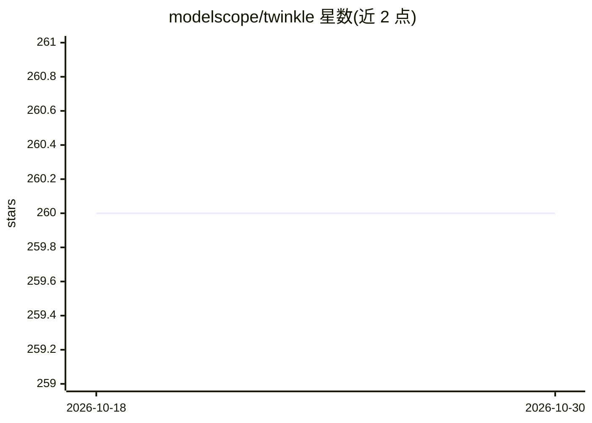

# modelscope/twinkle

⭐ 260 · Python · Apache-2.0 · 推送 2026-10-29 · [GitHub](https://github.com/modelscope/twinkle) · 组织维护 · 中文 README

**面向开发者的轻量级 Client-Server 大模型训练框架**

Twinkle 是 ModelScope 开源社区维护的训练框架：将训练逻辑封装为标准化 API，本地可用 torchrun、也可在 Ray 集群或 HTTP 模式运行，后端支持 Transformers 与 Megatron，覆盖 FSDP/LoRA/DPO/GRPO/PPO/蒸馏等训练类型。接口为 Tinker API 的超集，可通过 Tinker 客户端或原生客户端访问，支持在共享基座部署上多租户并行训练多个 LoRA，并提供基于 ModelScope 的 serverless 训练服务端点。支持 Nvidia GPU、Ascend NPU、PPU 与部分 CPU 组件。

## 筛选速览

| 维度 | 判定 | 备注 |
|---|---|---|
| AI 角色 | `ai-ecosystem` | LLM/agent 周边工具 |
| 许可风险 | `permissive` | Apache-2.0 |
| 部署形态 | `library` | 以包/库形式分发 |
| 模型依赖 | — | README 未给出锁定关系 |
| 硬件要求 | — | 无带数字的原话,不猜 |
| 安装摩擦 | `low` | 无编译、无系统依赖或容器化 |
| 成熟度 | — | 结构信号不足 |

## 能力要点

- torchrun / Ray / HTTP 三种运行模式，Transformers 与 Megatron 双后端
- 接口为 Tinker API 超集，兼容 Tinker 客户端访问
- LoRA Pool 架构支持多租户在单一基座部署上并行训练
- 提供 FSDP/DPO/GRPO/PPO/GKD 蒸馏等 18 类训练教程脚本

## 适用场景

- 本地或集群上对 Qwen、DeepSeek 等模型做 SFT/LoRA/RL 训练
- 通过 API 端点使用 ModelScope 上的 serverless 训练服务
- 在同一基座部署上为多租户并行训练隔离的 LoRA

## 场景标签

`微调` `模型训练` `强化学习` · 领域:训练与推理

## 证据(README 行号)

> L9: Twinkle✨ is a lightweight, client-server training framework engineered
> L14: abstraction, Twinkle✨ serves as a robust backend and gateway to enable serverless Training-as-a-Service (TaaS).
> L20: 🚀 Multiple Runtime Modes : torchrun / Ray / HTTP.

## 星数曲线

2026-10-18 260 → 2026-10-30 260（+0）

---
*卡片 v1 · prompt 1.4 · 生成 2026-10-22 · 置信度 high · 依据 README sha `ba0b3845510d` · [字段定义](../../DATASET.md)*
