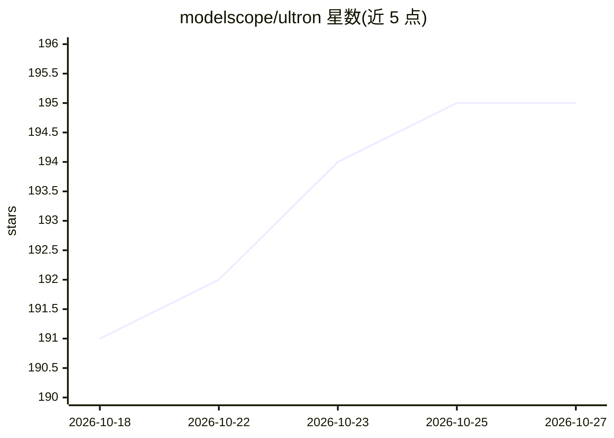

# modelscope/ultron

⭐ 195 · Python · Apache-2.0 · 推送 2026-10-26 · [GitHub](https://github.com/modelscope/ultron) · [官网](https://writtingforfun-ultron.ms.show) · 组织维护 · 中文 README

**面向通用 AI agent 的共享记忆/技能/配置 collective intelligence 系统**

由 ModelScope 团队维护的自演化集体智能服务端，含四大中心：Trajectory Hub 切分会话轨迹并产出质量指标，Memory Hub 做 HOT/WARM/COLD 分层记忆存储、语义检索、去重合并与 PII 脱敏，Skill Hub 将高频记忆结晶为可复用技能并随新证据再演化（含结构分数门槛），Harness Hub 发布/导入 agent 配置蓝图。服务端还可基于高质量轨迹自训练模型。agent 通过运行中的实例接入，服务端可自部署（源码/PyPI）。

## 筛选速览

| 维度 | 判定 | 备注 |
|---|---|---|
| AI 角色 | `ai-ecosystem` | LLM/agent 周边工具 |
| 许可风险 | `permissive` | Apache-2.0 |
| 部署形态 | `library` | 以包/库形式分发 |
| 模型依赖 | — | README 未给出锁定关系 |
| 硬件要求 | — | 无带数字的原话,不猜 |
| 安装摩擦 | `low` | 无编译、无系统依赖或容器化 |
| 成熟度 | — | 结构信号不足 |

## 能力要点

- HOT/WARM/COLD 分层记忆与 L0/L1/Full 摘要分层，节省检索 token
- 记忆语义聚类后自动结晶为多步技能，带溯源校验与升级门槛防回退
- 索引 82,089 个 ModelScope 外部技能并与内部技能统一检索
- Presidio 双语（EN/ZH）PII 检测与自动脱敏

## 适用场景

- 让多个 agent 共享踩坑经验，避免重复排查同类问题
- SRE 把运维排障流程沉淀为可复用技能包供其他团队 agent 使用
- 调优好的专家 agent 配置一键发布为蓝图供他人在 Nanobot/OpenClaw 等导入

## 场景标签

`Agent 记忆` · 领域:Agent 开发

## 证据(README 行号)

> L33: Ultron is a **self-evolving collective intelligence system** for general-purpose AI agents, built around three core
> L28: |**Connect my agent** to an existing Ultron service|→ Agent Setup|
> L29: |**Self-host Ultron** and run the server myself|→ Server Deployment|

## 星数曲线

2026-10-18 191 → 2026-10-27 195（+4）

---
*卡片 v1 · prompt 1.4 · 生成 2026-10-22 · 置信度 high · 依据 README sha `8177fb4ac43c` · [字段定义](../../DATASET.md)*
