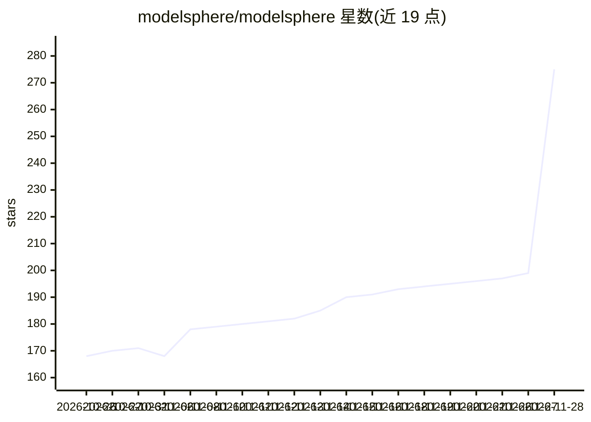

# modelsphere/modelsphere

⭐ 275 · Shell · Apache-2.0 · 推送 2026-11-27 · [GitHub](https://github.com/modelsphere/modelsphere) · [官网](https://modelsphere.tech) · 组织维护 · 中文 README

**生产级 LLM 推理基础设施，多加速器统一部署与服务**

开源 LLM 推理平台，以 Kubernetes 为主的部署形态，通过 Helm chart 安装整套组件：会话亲和路由（llm-openresty）、前缀缓存感知路由（CART）、基于 KV 缓存压力与队列深度的自动扩缩（llm-operator）、SLO 驱动的副本决策、hang-watcher 自愈、请求级日志与 Prometheus 指标，以及带登录与角色管理的 console 门户。支持 Prefill/Decode 分离与统一 KV 缓存池，覆盖 NVIDIA GPU、华为昇腾等多类加速器，另提供无 Kubernetes 的 Docker 部署路径与离线安装文档。

## 筛选速览

| 维度 | 判定 | 备注 |
|---|---|---|
| AI 角色 | `ai-ecosystem` | LLM/agent 周边工具 |
| 许可风险 | `permissive` | Apache-2.0 |
| 部署形态 | `library` | 以包/库形式分发 |
| 模型依赖 | local-ok | 支持本地模型 |
| 硬件要求 | — | 无带数字的原话,不猜 |
| 安装摩擦 | `low` | 无编译、无系统依赖或容器化 |
| 成熟度 | — | 结构信号不足 |

## 能力要点

- Prefill/Decode 分离架构与统一 L3 KV 缓存池
- 基于 TTFT/输出速度的质量感知动态限流
- Pod 故障时中断点续传的 In-Flight Generation Recovery
- 覆盖 NVIDIA GPU、华为昇腾、Iluvatar CoreX 等异构加速器

## 适用场景

- 在 Kubernetes 集群上部署和管理多模型 LLM 服务
- 多团队共享 GPU 集群时按优先级调度推理资源
- 昇腾等国产加速器上的离线环境模型部署

## 场景标签

`推理引擎` · 领域:训练与推理

## 证据(README 行号)

> L13: ModelSphere is an open-source LLM inference platform designed to make production-grade model serving simple, effici
> L23: - **Broad Heterogeneous Accelerator Support.** Provides a unified serving stack across NVIDIA GPUs, Huawei Ascend, 
> L98: |llm-operator|Autoscales inference workloads on LLM-specific signals (KV-cache pressure, queue depth)|llm-operator|

## 星数曲线

2026-10-26 168 → 2026-11-28 275（+107）

---
*卡片 v1 · prompt 1.4 · 生成 2026-11-25 · 置信度 high · 依据 README sha `a6a0a044245d` · [字段定义](../../DATASET.md)*
