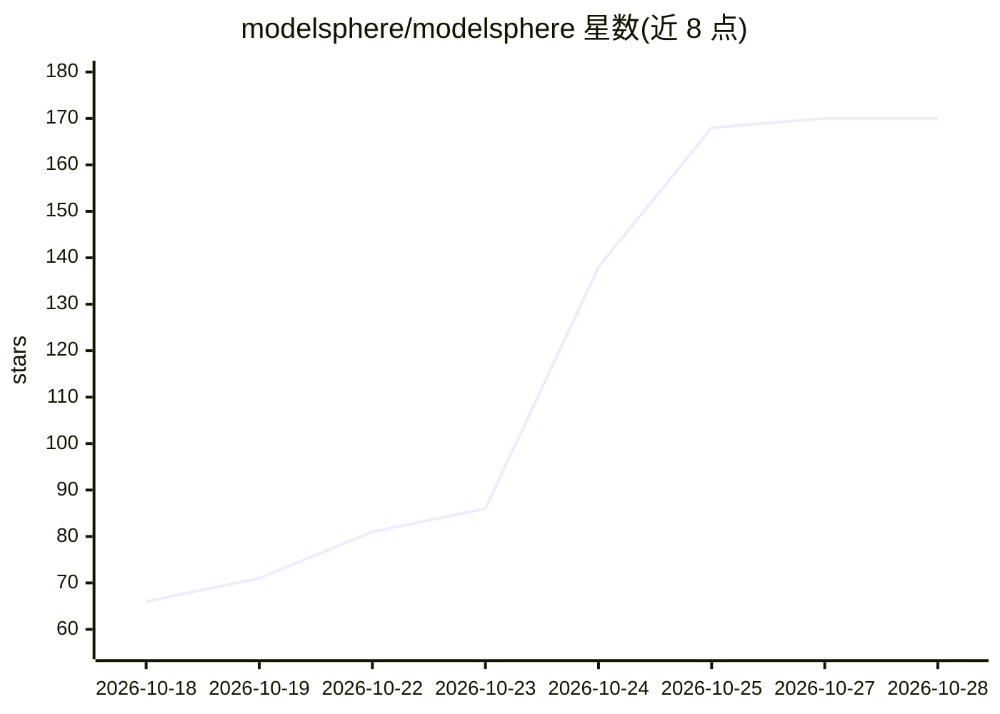

# modelsphere/modelsphere

⭐ 170 · Shell · Apache-2.0 · 推送 2026-10-28 · [GitHub](https://github.com/modelsphere/modelsphere) · 组织维护 · 中文 README

**面向生产环境的 LLM 推理平台，Kubernetes 上部署与调度多后端模型服务**

基于 Kubernetes 的开源 LLM 推理基础设施：通过 helm/helmfile 安装整套栈，以 OpenResty 路由层暴露 OpenAI 兼容接口，支持 SGLang 与 vLLM 等推理引擎及 NVIDIA GPU、华为昇腾等多种加速器。组件包括会话亲和与缓存感知路由、基于 KV-cache 压力等 LLM 信号的自动扩缩容、按 TTFT 等指标动态限流、in-flight 请求跨 Pod 恢复，以及带 GUI 控制台的社区门户。Workload 驱动的 AutoTune 处于预览版。

## 筛选速览

| 维度 | 判定 | 备注 |
|---|---|---|
| AI 角色 | `ai-ecosystem` | LLM/agent 周边工具 |
| 许可风险 | `permissive` | Apache-2.0 |
| 部署形态 | `library` | 以包/库形式分发 |
| 模型依赖 | local-ok | 支持本地模型 |
| 硬件要求 | — | 无带数字的原话,不猜 |
| 安装摩擦 | `low` | 无编译、无系统依赖或容器化 |
| 成熟度 | `idea` | |

## 能力要点

- NVIDIA/华为昇腾等异构加速器与 SGLang、vLLM 引擎的统一服务栈
- 基于 KV-cache 压力与队列深度的推理副本自动扩缩容
- 按 TTFT/输出速度等服务质量指标动态限流
- serving pod 故障时 in-flight 请求迁移续生成

## 适用场景

- 在 Kubernetes 集群上以生产配置部署 LLM 推理服务
- 多模型多副本场景下做路由、限流与自动扩缩容
- 新模型发布后快速获得性能调优过的部署配置

## 场景标签

`推理引擎` · 领域:训练与推理

## 证据(README 行号)

> L13: ModelSphere is an open-source LLM inference platform designed to make production-grade model serving simple, effici
> L23: - **Broad Heterogeneous Accelerator Support.** Provides a unified serving stack across NVIDIA GPUs, Huawei Ascend, 

## 星数曲线

2026-10-18 66 → 2026-10-28 170（+104）

---
*卡片 v1 · prompt 1.4 · 生成 2026-10-23 · 置信度 high · 依据 README sha `689c556399fe` · [字段定义](../../DATASET.md)*
