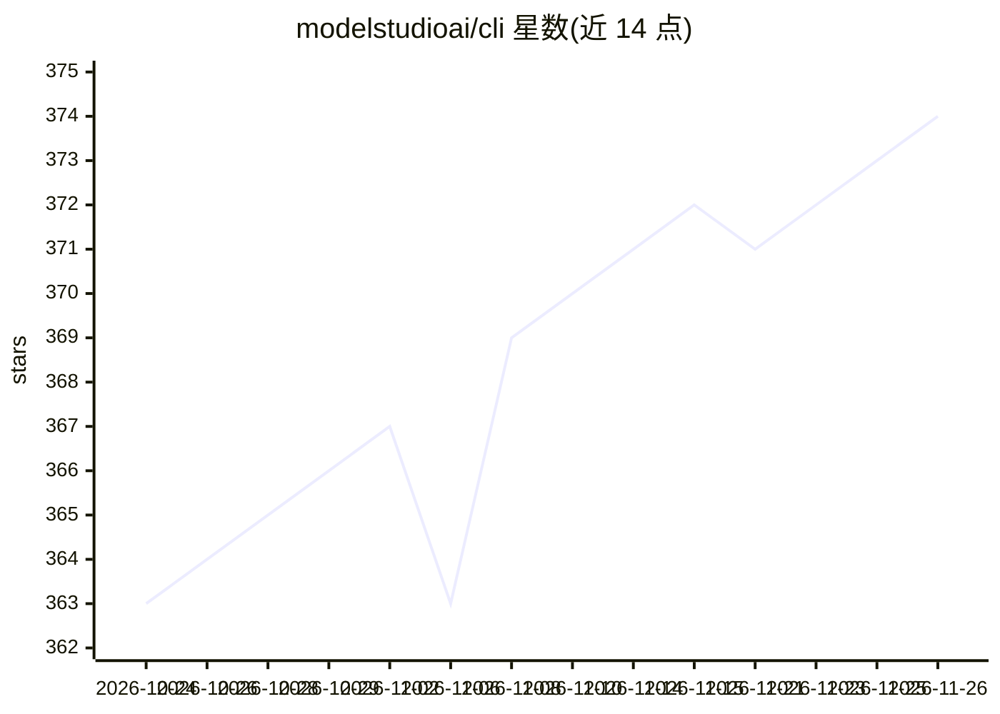

# modelstudioai/cli

⭐ 374 · TypeScript · Apache-2.0 · 推送 2026-11-25 · [GitHub](https://github.com/modelstudioai/cli) · [官网](https://bailian.console.aliyun.com/cli) · 组织维护 · 中文 README

**阿里云百炼官方 CLI：为 AI Agent 提供模型/搜索/多模态/工作流工具调用**

阿里云 Model Studio（百炼/DashScope）平台的官方命令行工具，以 Node.js/TypeScript 构建。每条命令以结构化 tool call 形式暴露，供 AI Agent 框架调用：覆盖文本/图像/视频/语音生成、图像与长视频理解、托管 Agent 与工作流的创建发布、百炼 MCP 服务器向 Codex/Claude Code/Cursor 等注册、SFT/DPO/CPT 微调与 RL 训练、批量推理、账号配额与订阅管理。支持 npm 与 macOS/Linux/Windows 脚本安装，需 API key 与 workspace；部分功能仅限中国站账号。

## 筛选速览

| 维度 | 判定 | 备注 |
|---|---|---|
| AI 角色 | `ai-ecosystem` | LLM/agent 周边工具 |
| 许可风险 | `permissive` | Apache-2.0 |
| 部署形态 | `library` | 以包/库形式分发 |
| 模型依赖 | — | README 未给出锁定关系 |
| 硬件要求 | — | 无带数字的原话,不猜 |
| 安装摩擦 | `low` | 无编译、无系统依赖或容器化 |
| 成熟度 | — | 结构信号不足 |

## 能力要点

- 命令以结构化 tool call 形式暴露给 AI Agent 框架
- 原生 MCP setup：将百炼 MCP 服务器注册到 Codex/Claude Code/Cursor 等 9 类客户端
- 覆盖训练（SFT/DPO/CPT/RL）、批量推理、知识库与 ParseX 文档解析
- npm、shell、PowerScript 三种安装路径，脚本安装无需 Node.js

## 适用场景

- 让本地 coding agent 直接调用百炼的图像/视频/语音生成能力
- 从命令行管理微调数据集、批量推理任务与专属端点部署
- 为团队配置用量配额、限流与监控告警规则

## 场景标签

`图像生成` `视频生成` `文档解析` `微调` · 领域:内容生成

## 证据(README 行号)

> L3: **The official command-line interface for Aliyun Model Studio (DashScope) AI Platform**
> L16: _Built for AI Agents. Every command works as a structured tool call._
> L22: - **App orchestration** — Call Managed Agents, agents, and workflows published on Aliyun Model Studio, wired to kno

## 星数曲线

2026-10-24 363 → 2026-11-26 374（+11）

---
*卡片 v1 · prompt 1.4 · 生成 2026-11-26 · 置信度 high · 依据 README sha `5313ff1db9f5` · [字段定义](../../DATASET.md)*
