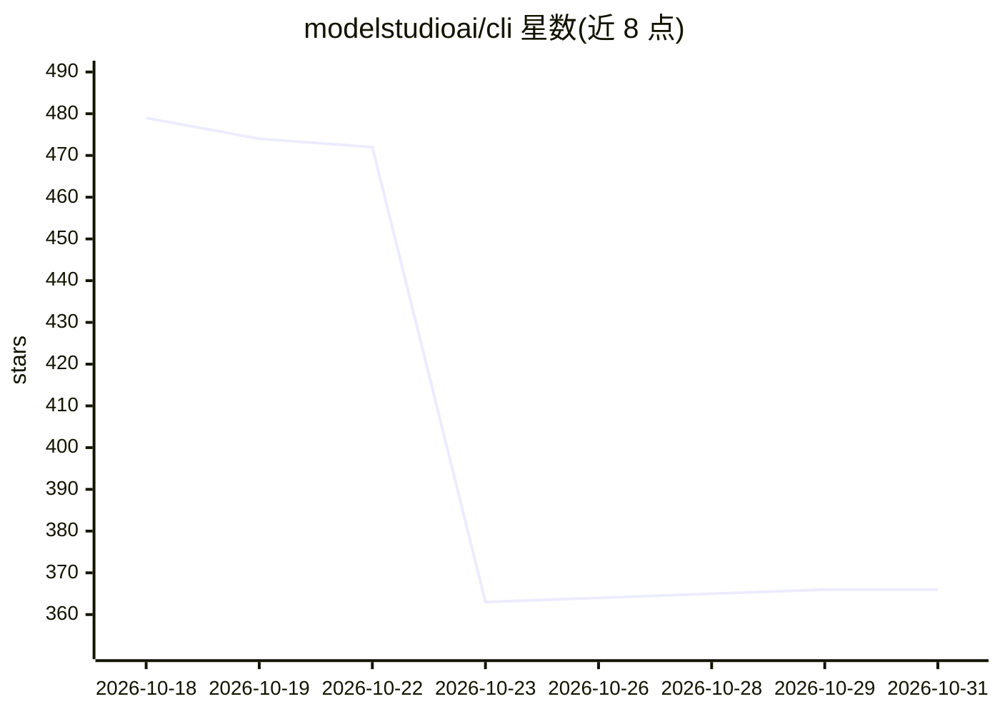

# modelstudioai/cli

⭐ 366 · TypeScript · Apache-2.0 · 推送 2026-10-30 · [GitHub](https://github.com/modelstudioai/cli) · [官网](https://bailian.console.aliyun.com/cli) · 组织维护 · 中文 README

**阿里云百炼官方 CLI：为 AI Agent 提供百炼模型能力的命令行工具**

阿里云百炼（DashScope）平台的官方命令行工具，以结构化工具调用形式向 AI Agent 暴露平台能力：文本/图像/视频/语音的全模态生成与编辑、图像/文档/音视频理解、调用平台上托管的 Agent 与工作流、数据集校验上传、模型微调与专属部署、账号与配额管理。支持在 Codex、Claude Code、Cursor 等编码 Agent 中注册百炼 MCP 服务器。提供 npm、shell 脚本、PowerShell 三种安装方式；部分功能（应用编排、训练部署、账号操作）仅限中国站账号。

## 筛选速览

| 维度 | 判定 | 备注 |
|---|---|---|
| AI 角色 | `ai-ecosystem` | LLM/agent 周边工具 |
| 许可风险 | `permissive` | Apache-2.0 |
| 部署形态 | `library` | 以包/库形式分发 |
| 模型依赖 | — | README 未给出锁定关系 |
| 硬件要求 | — | 无带数字的原话,不猜 |
| 安装摩擦 | `low` | 无编译、无系统依赖或容器化 |
| 成熟度 | — | 结构信号不足 |

## 能力要点

- 全模态生成与编辑（文本/图像/视频/语音）及素材理解
- MCP 服务器一键注册到 Codex、Claude Code、Cursor、Qwen Code 等 Agent
- 数据集校验上传、模型微调与专属端点部署
- 三种认证方式：控制台 OAuth 登录、API Key、阿里云 AK/SK

## 适用场景

- 让编码 Agent 通过自然语言调用百炼的生成、识别与检索能力
- 在 Claude Code / Cursor 等工具中接入百炼 MCP 服务器
- 用命令行管理百炼账号的模型用量、配额与限流
- 通过 CLI 完成数据集上传与模型微调部署

## 场景标签

`模型网关` `微调` · 领域:Agent 开发

## 证据(README 行号)

> L16: _Built for AI Agents. Every command works as a structured tool call._
> L23: - **Native MCP setup** — Register Bailian MCP servers in Codex, Claude Code, Cursor, Qoder, Qoder Work, QwenWork (千

## 星数曲线

2026-10-18 479 → 2026-10-31 366（-113）

---
*卡片 v1 · prompt 1.4 · 生成 2026-10-21 · 置信度 high · 依据 README sha `0f7c687617ab` · [字段定义](../../DATASET.md)*
