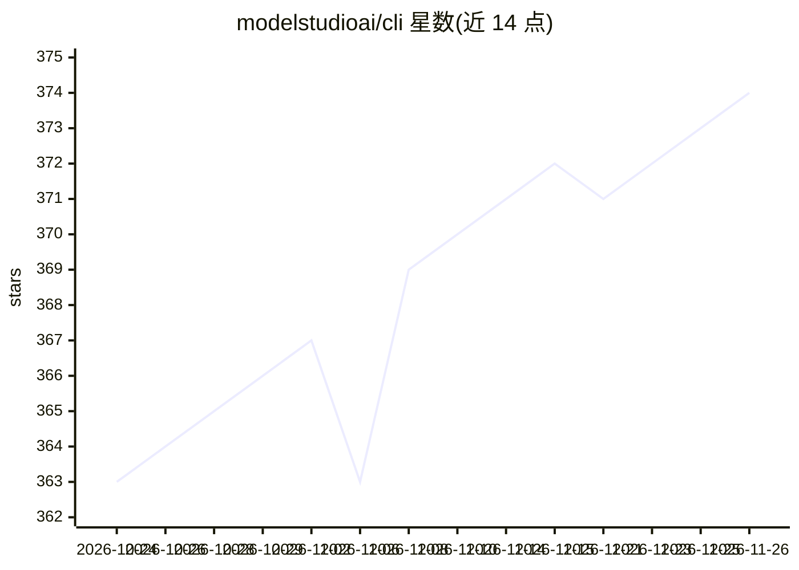

# modelstudioai/cli

⭐ 374 · TypeScript · Apache-2.0 · 推送 2026-11-25 · [GitHub](https://github.com/modelstudioai/cli) · [官网](https://bailian.console.aliyun.com/cli) · 组织维护 · 中文 README

**面向 AI Agent 的阿里云百炼官方 CLI，把模型与工作流暴露为工具调用**

阿里云百炼（DashScope）平台的官方命令行工具，用 Node.js/TypeScript 实现。功能覆盖文本/图像/视频/语音生成、图片与长视频理解、调用平台上发布的 Managed Agent 与工作流、数据集校验上传、SFT/DPO/CPT 微调与部署、批量推理、知识库管理与账号配额操作。每个命令设计为结构化工具调用供 AI Agent 使用，并提供原生命令把百炼 MCP 服务器注册进 Codex、Claude Code、Cursor 等编程 Agent。应用编排、训练部署与账号功能仅限中国站账号。

## 筛选速览

| 维度 | 判定 | 备注 |
|---|---|---|
| AI 角色 | `ai-ecosystem` | LLM/agent 周边工具 |
| 许可风险 | `permissive` | Apache-2.0 |
| 部署形态 | `library` | 以包/库形式分发 |
| 模型依赖 | — | README 未给出锁定关系 |
| 硬件要求 | — | 无带数字的原话,不猜 |
| 安装摩擦 | `low` | 无编译、无系统依赖或容器化 |
| 成熟度 | — | 结构信号不足 |

## 能力要点

- 全模态生成与理解：文本/图像/视频/语音的生成、编辑与解析
- 每条命令可作为结构化工具调用供 AI Agent 框架使用
- 支持微调（SFT/DPO/CPT）、RL 任务沙箱与专属模型端点部署
- 原生 MCP 注册到 Codex/Claude Code/Cursor/Qwen Code 等客户端

## 适用场景

- 让编程 Agent 直接调用百炼平台的模型、知识库与工作流
- 命令行管理模型微调数据集、批量推理任务与部署实例
- 从一句话生成图像并转为视频的多模态创作流程
- 查询模型用量、配额、限流与调用监控告警

## 场景标签

`图像生成` `视频生成` `微调` `模型网关` · 领域:Agent 开发

## 证据(README 行号)

> L3: **The official command-line interface for Aliyun Model Studio (DashScope) AI Platform**
> L16: _Built for AI Agents. Every command works as a structured tool call._
> L23: - **Native MCP setup** — Register Bailian MCP servers in Codex, Claude Code, Cursor, Qoder, Qoder Work, QwenWork (千

## 星数曲线

2026-10-24 363 → 2026-11-26 374（+11）

---
*卡片 v1 · prompt 1.4 · 生成 2026-11-25 · 置信度 high · 依据 README sha `f169251e3ce3` · [字段定义](../../DATASET.md)*
