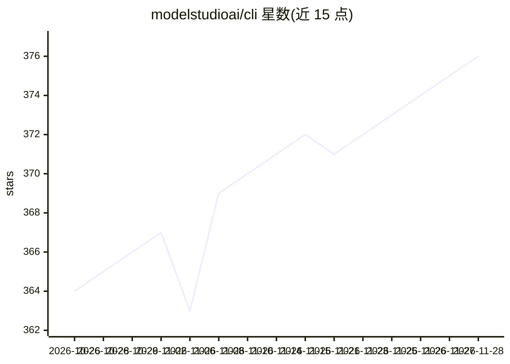

# modelstudioai/cli

⭐ 376 · TypeScript · Apache-2.0 · 推送 2026-11-27 · [GitHub](https://github.com/modelstudioai/cli) · [官网](https://bailian.console.aliyun.com/cli) · 组织维护 · 中文 README

**阿里云百炼官方 CLI：一条命令调用模型、语音、工作流等能力**

面向 AI Agent 框架的阿里云 Model Studio（百炼）官方命令行工具，用 Node.js/TypeScript 构建。每个命令可作为结构化工具调用被 Agent 使用；支持通过安装脚本把百炼 MCP 服务器注册到 Codex、Claude Code、Cursor 等客户端。功能覆盖文本/图像/视频/语音生成、资产理解、Agent/工作流编排、SFT/DPO 微调与部署、批量推理、账户与配额管理、知识库导入和文档解析。部分功能仅限中国站（aliyun.com）账户使用。

## 筛选速览

| 维度 | 判定 | 备注 |
|---|---|---|
| AI 角色 | `ai-ecosystem` | LLM/agent 周边工具 |
| 许可风险 | `permissive` | Apache-2.0 |
| 部署形态 | `library` | 以包/库形式分发 |
| 模型依赖 | — | README 未给出锁定关系 |
| 硬件要求 | — | 无带数字的原话,不猜 |
| 安装摩擦 | `low` | 无编译、无系统依赖或容器化 |
| 成熟度 | — | 结构信号不足 |

## 能力要点

- 每个命令以结构化工具调用形式供 Agent 使用
- 原生 MCP 设置：一键注册百炼 MCP 服务器到 Codex/Claude Code/Cursor 等客户端
- 覆盖训练部署（SFT/DPO/CPT、RL 任务、OPD 蒸馏）与批量推理
- 支持知识库导入、RAG 音视频与 ParseX 文档/音视频结构化解析

## 适用场景

- 让编码 Agent 直接调用百炼的图像、视频与语音能力
- 命令行微调模型并部署为专属端点
- 创建和发布带知识库与网络搜索的托管 Agent 应用
- 批量提交 Chat/Embedding 异步推理任务并下载结果

## 场景标签

`图像生成` `视频生成` `文档解析` `RAG` · 领域:内容生成

## 证据(README 行号)

> L3: **The official command-line interface for Aliyun Model Studio (DashScope) AI Platform**
> L16: _Built for AI Agents. Every command works as a structured tool call._
> L22: - **App orchestration** — Call Managed Agents, agents, and workflows published on Aliyun Model Studio, wired to kno

## 星数曲线

2026-10-26 364 → 2026-11-28 376（+12）

---
*卡片 v1 · prompt 1.4 · 生成 2026-11-28 · 置信度 high · 依据 README sha `bfb8f65517d5` · [字段定义](../../DATASET.md)*
