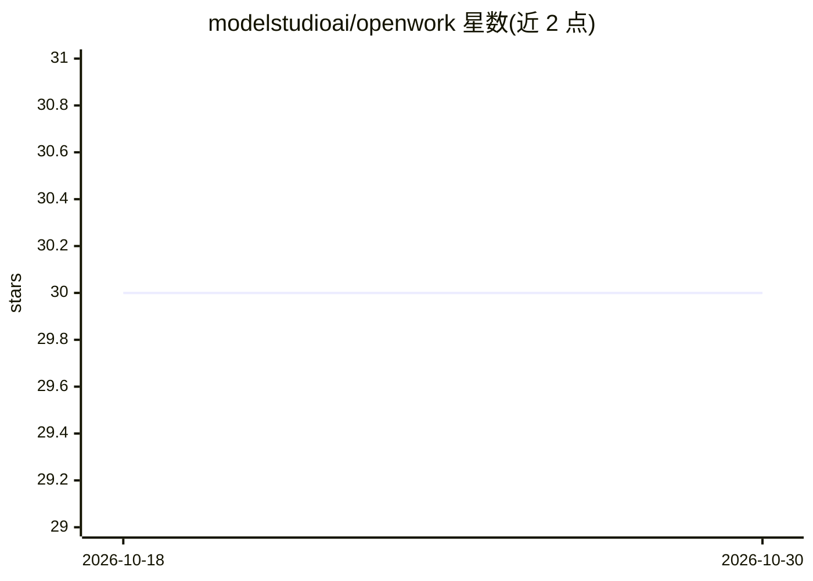

# modelstudioai/openwork

⭐ 30 · TypeScript · Apache-2.0 · 推送 2026-08-18 · [GitHub](https://github.com/modelstudioai/openwork) · [官网](https://modelstudioai.github.io/openwork/) · 组织维护 · 中文 README

**本地优先的 AI agent 工作流桌面应用**

ModelStudio 推出的桌面应用，供用户在本地与 AI agent 协作：多会话管理、对接本地代码库与文件系统、agent 对话界面展示工具调用与执行结果、代码执行与调试、文件与产物预览、连接 MCP/GitHub 等外部数据源、技能扩展与权限模式控制。架构为桌面应用 + agent runtime：前者管会话、工作区、权限确认，后者管模型交互、工具调用与命令执行。macOS/Windows/Linux 跨平台分发，与 ModelStudio CLI 互补。

## 筛选速览

| 维度 | 判定 | 备注 |
|---|---|---|
| AI 角色 | `ai-native` | 本体是模型或模型工具 |
| 许可风险 | `permissive` | Apache-2.0 |
| 部署形态 | `None` |  |
| 模型依赖 | — | README 未给出锁定关系 |
| 硬件要求 | — | 无带数字的原话,不猜 |
| 安装摩擦 | `low` | 无编译、无系统依赖或容器化 |
| 成熟度 | — | 结构信号不足 |

## 能力要点

- 多会话管理与本地项目工作区，agent 可读项目、跑命令、改代码并验证
- 支持 MCP 服务器、本地文件系统、GitHub 等外部连接
- 文件/命令/外部调用的权限模式确认机制
- 将领域知识与团队流程沉淀为可复用技能

## 适用场景

- 让 agent 在本地代码库中诊断测试失败、修复并自动验证
- 跨终端/编辑器/工具平台的长时 agent 任务统一在一个桌面工作区管理
- 在需要权限确认的环境中使用 agent 自动化
- 把团队重复流程封装为技能或自动化工作流

## 场景标签

`Agent 框架` `编码 Agent` · 领域:Agent 开发

## 证据(README 行号)

> L3: **A local-first desktop application for AI agent workflows from ModelStudio.**
> L5: OpenWork lets you work with AI agents on your desktop: chat with agents, manage multiple sessions, connect local pro
> L43: OpenWork runs as a desktop application paired with an agent runtime.

## 星数曲线

2026-10-18 30 → 2026-10-30 30（+0）

---
*卡片 v1 · prompt 1.4 · 生成 2026-10-26 · 置信度 mid · 依据 README sha `8db24521a107` · [字段定义](../../DATASET.md)*
