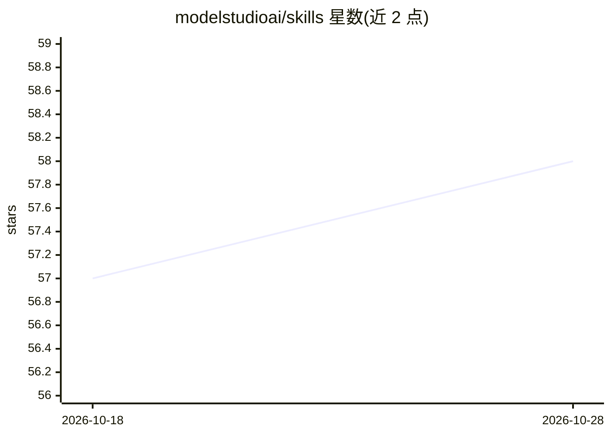

# modelstudioai/skills

⭐ 58 · Python · Apache-2.0 · 推送 2026-10-27 · [GitHub](https://github.com/modelstudioai/skills) · [官网](https://modelstudioai.github.io/skills/) · 组织维护 · 中文 README

**阿里云百炼官方 Agent Skills 技能仓库与策展索引**

ModelStudio 团队维护的 Agent Skills 集合，分两类：一方技能（本仓库自带，含百炼文档检索、模型推荐、金融数据分析、短视频/小说游戏生成等 8 个，经 `bl`（bailian-cli）调用百炼平台的对话、多模态、图像视频、语音、RAG、联网搜索能力）；以及从 GitHub、Anthropic、Vercel、Google Labs 等社区持续追踪并经实际场景验证的第三方技能索引，按技能管理、代码开发、设计创意、文档、视频、测试六类组织。需要阿里云百炼 API Key，技能代用户调用 API 将计入账户计费。

## 筛选速览

| 维度 | 判定 | 备注 |
|---|---|---|
| AI 角色 | `ai-knowledge` | 知识聚合/清单类 |
| 许可风险 | `permissive` | Apache-2.0 |
| 部署形态 | `library` | 以包/库形式分发 |
| 模型依赖 | — | README 未给出锁定关系 |
| 硬件要求 | — | 无带数字的原话,不猜 |
| 安装摩擦 | `medium` | 含编译或系统依赖之一 |
| 成熟度 | — | 结构信号不足 |

## 能力要点

- 一方技能 8 个：文档导航、模型推荐、金融数据、视频/小说游戏生成等
- 第三方技能经团队实际验证后按 6 大场景编目
- npx skills add 一条命令安装，可由 AI Agent 代为执行
- 需要百炼 API Key；生成内容经 `bl` 计费到用户的阿里云账户

## 适用场景

- 为自己的 AI Agent 安装百炼平台一方技能（模型推荐、金融分析、视频生产等）
- 查找并安装经过验证的第三方 Claude Code / Agent Skill
- 让 Agent 通过 bailian-cli 调用通义系列与百炼全模态能力

## 场景标签

`精选清单` · 领域:学习与行业

## 证据(README 行号)

> L16: ModelStudio Skills is the official AI Agent Skills repository from ModelStudio, containing two categories:
> L19: - **Curated 3rd-party skills** — Continuously tracked from GitHub, Anthropic, Vercel, Google Labs, and other commun
> L21: Each skill is an independent, composable workflow unit. The 3rd-party set spans **skill management, code developmen

## 星数曲线

2026-10-18 57 → 2026-10-28 58（+1）

---
*卡片 v1 · prompt 1.4 · 生成 2026-10-24 · 置信度 high · 依据 README sha `a854b466b2ec` · [字段定义](../../DATASET.md)*
