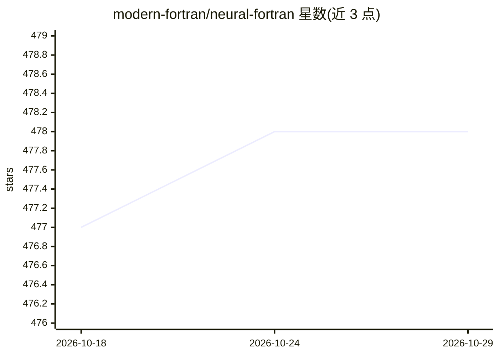

# modern-fortran/neural-fortran

⭐ 478 · Fortran · MIT · 推送 2026-10-05 · [GitHub](https://github.com/modern-fortran/neural-fortran) · 组织维护

**Fortran 并行深度学习框架，供科研开发者训练推理神经网络**

用纯 Fortran 实现的深度学习框架，支持稠密层、一维/二维卷积、自注意力与 Transformer 网络的训练与推理，提供 7 种 SGD 系优化器、十余种激活函数与多种损失/度量函数，并支持数据并行（经 OpenCoarrays/caf 编译）。可从 Keras HDF5 文件加载稠密与卷积模型（配套 nf-keras-hdf5 附加包）。构建方式为 fpm 或 CMake，需 Fortran 编译器（flang-new/gfortran/ifort/ifx 均有测试记录），BLAS/MKL 与 curl 为可选依赖。附 MNIST 等示例，CNN 与 Keras HDF5 适配部分由 NASA Goddard 合同资助开发。

## 筛选速览

| 维度 | 判定 | 备注 |
|---|---|---|
| AI 角色 | `ai-native` | 本体是模型或模型工具 |
| 许可风险 | `permissive` | MIT |
| 部署形态 | `None` |  |
| 模型依赖 | — | README 未给出锁定关系 |
| 硬件要求 | — | 无带数字的原话,不猜 |
| 安装摩擦 | `medium` | 含编译或系统依赖之一 |
| 成熟度 | — | 结构信号不足 |

## 能力要点

- 稠密/卷积/自注意力（Transformer）网络训练与推理
- 7 种 SGD 系优化器（含 Adam/AdamW/RMSProp 等）
- 基于 OpenCoarrays 与 caf 包装器的数据并行执行
- 从 Keras HDF5 (.h5) 文件加载稠密与卷积模型

## 适用场景

- 在 Fortran 代码库中直接训练和部署神经网络
- 利用数据并行在多核上运行训练
- 将 Keras 训练的模型导入 Fortran 环境做推理

## 场景标签

`模型训练` `推理引擎` · 领域:训练与推理

## 证据(README 行号)

> L3: A parallel framework for deep learning.
> L18: * Training and inference of dense (fully connected), convolutional (1-d and 2-d),
> L24: * Data-based parallelism

## 星数曲线

2026-10-18 477 → 2026-10-29 478（+1）

---
*卡片 v1 · prompt 1.4 · 生成 2026-10-21 · 置信度 high · 依据 README sha `b3b124048602` · [字段定义](../../DATASET.md)*
