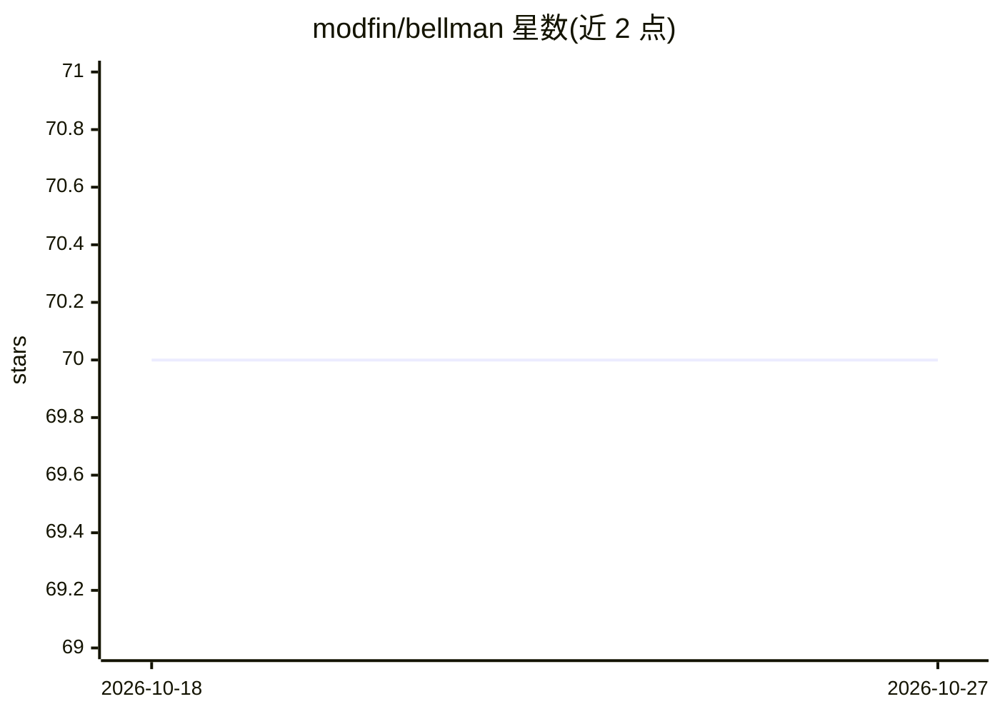

# modfin/bellman

⭐ 70 · Go · MIT · 推送 2026-10-23 · [GitHub](https://github.com/modfin/bellman) · 组织维护

**Go 语言多厂商 LLM 统一接口库与代理服务**

由两部分组成：Go 库提供 Anthropic、OpenAI、VertexAI/Gemini、VoyageAI、Ollama、vLLM、TypeSafe 等厂商的客户端，实现 gen.Gen/embed.Embeder/decide.Decider 接口，可互换使用，覆盖 Chat、结构化输出（Go struct 转 JSON schema）、工具调用、图像/PDF 输入、推理级别控制与上下文感知嵌入；服务端 bellmand 以 Docker 运行，作为 HTTP 代理用单一 API key 接入全部厂商。另提供 Decision 模型类型，以概率分布回答类型化问题，适用于分类、路由与阈值判断。MIT 许可。

## 筛选速览

| 维度 | 判定 | 备注 |
|---|---|---|
| AI 角色 | `ai-ecosystem` | LLM/agent 周边工具 |
| 许可风险 | `permissive` | MIT |
| 部署形态 | `self-host` | docker 或自建部署 |
| 模型依赖 | local-ok | 支持本地模型 |
| 硬件要求 | — | 无带数字的原话,不猜 |
| 安装摩擦 | `low` | 无编译、无系统依赖或容器化 |
| 成熟度 | — | 结构信号不足 |

## 能力要点

- 统一接口接入 Anthropic/OpenAI/VertexAI/Ollama/vLLM/VoyageAI/TypeSafe 七类厂商
- bellmand 代理服务以单一 API key 经 HTTP 转发请求
- 结构化输出：Go struct 注解转 JSON schema
- Decision 模型：Predicate/Choice/Score 三类问题返回概率分布

## 适用场景

- Go 项目中在多个 LLM 厂商间切换而少改代码
- 统一 API key 代理全厂商模型的内部网关
- 用概率分布做分类、路由与阈值判定

## 场景标签

`模型网关` · 领域:Agent 开发

## 证据(README 行号)

> L5: It tries to be a unified interface to interact with LLMs and embedding models.
> L11: The go library enables you to interact with the different LLM vendors directly while the service,
> L62: The library provides clients for Anthropic, Ollama, OpenAI, VertexAI, VoyageAI, vLLM, TypeSafe and Bellman itself.

## 星数曲线

2026-10-18 70 → 2026-10-27 70（+0）

---
*卡片 v1 · prompt 1.4 · 生成 2026-10-24 · 置信度 high · 依据 README sha `fe6b0e002ca9` · [字段定义](../../DATASET.md)*
