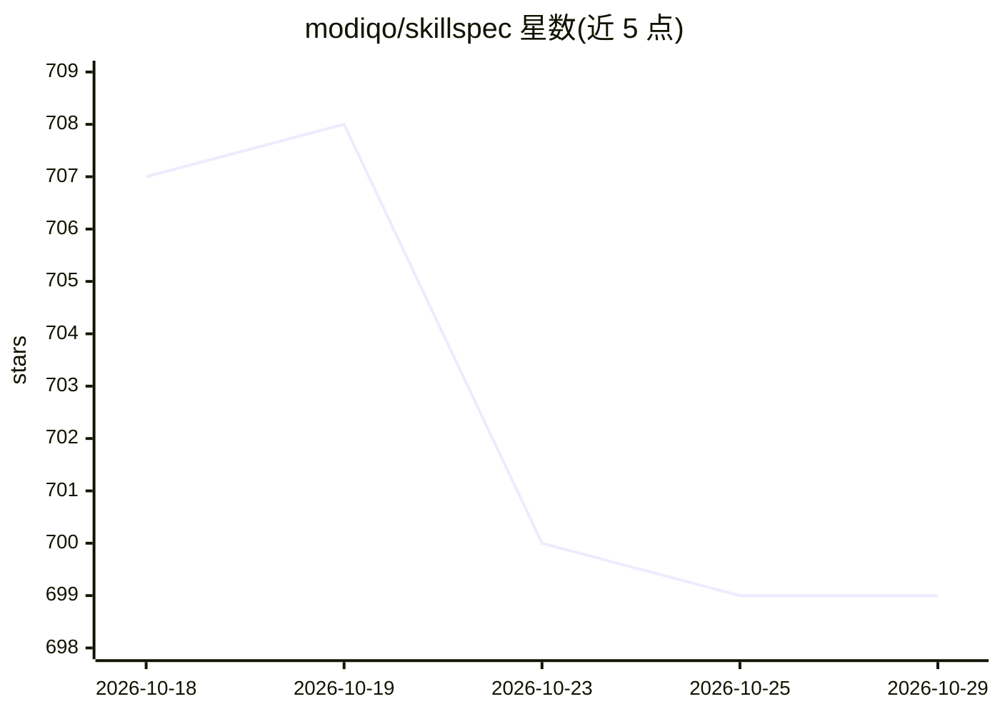

# modiqo/skillspec

⭐ 699 · Rust · Apache-2.0 · 推送 2026-08-09 · [GitHub](https://github.com/modiqo/skillspec) · [官网](https://skillspec.sh) · 组织维护

**Agent 技能的结构化契约与风险审计 CLI**

面向使用 SKILL.md 技能的 agent 开发者：通过 `skillspec doctor` 对技能做风险评估（发现风险、上下文负载、被埋没的规则、未声明依赖），将散文式 SKILL.md 导入为结构化 skill.spec.yml 契约（路由、禁令、依赖、检查、证明），运行后产出可审计的 alignment 摘要。附带 boundary 子命令分析技能可触达的网络/文件/凭据并生成最小权限策略。以 CLI 形式提供，支持 Claude Code、Codex 插件安装；自身不是 agent 运行时。Rust 实现，提供预编译二进制。

## 筛选速览

| 维度 | 判定 | 备注 |
|---|---|---|
| AI 角色 | `ai-ecosystem` | LLM/agent 周边工具 |
| 许可风险 | `permissive` | Apache-2.0 |
| 部署形态 | `desktop` | 安装包/桌面程序 |
| 模型依赖 | — | README 未给出锁定关系 |
| 硬件要求 | — | 无带数字的原话,不猜 |
| 安装摩擦 | `low` | 无编译、无系统依赖或容器化 |
| 成熟度 | — | 结构信号不足 |

## 能力要点

- Doctor 命令对技能输出风险评估报告（Markdown/HTML/JSON）
- 将 SKILL.md 导入为 skill.spec.yml 结构化契约并编译轻量加载器
- boundary 子命令映射技能可达范围并生成 deny-by-default 策略
- 运行后输出 alignment 摘要：所选路由、完成步骤、缺失证明、token 用量

## 适用场景

- 在安装或移植公开技能前评估其风险
- 把依赖的关键技能转为可检查、可证明的契约
- 限制技能可访问的网络、文件与凭据范围
- 技能库过多时用 router 模式按需路由

## 场景标签

`模型评测` · 领域:评测与运维

## 证据(README 行号)

> L10: **SkillSpec tells you.** Run one command and get a risk report. Then turn any
> L178: SkillSpec generates a `skill.spec.yml` next to your `SKILL.md`: routes, rules,
> L210: |A CLI that scores, ports, compiles, and records.|A new agent runtime or orchestration platform.|

## 星数曲线

2026-10-18 707 → 2026-10-29 699（-8）

---
*卡片 v1 · prompt 1.4 · 生成 2026-10-21 · 置信度 high · 依据 README sha `538d8a8c3146` · [字段定义](../../DATASET.md)*
