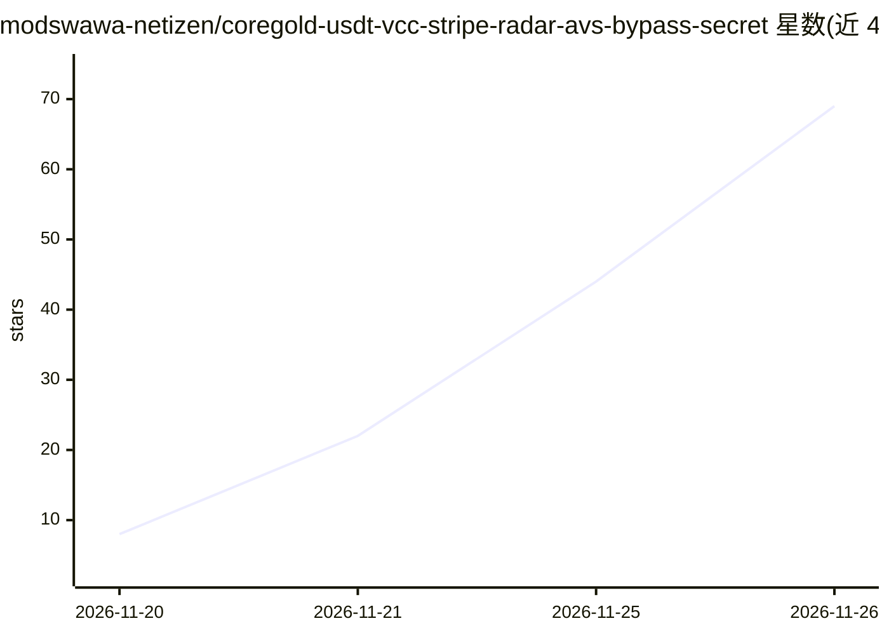

# modswawa-netizen/coregold-usdt-vcc-stripe-radar-avs-bypass-secret

⭐ 69 · 推送 2026-11-19 · [GitHub](https://github.com/modswawa-netizen/coregold-usdt-vcc-stripe-radar-avs-bypass-secret) · [官网](https://app.coregold.io/signup?invite_code=ADvlj9b) · 组织维护 · 中文 README

**讲解 Stripe Radar 拒付原理并推广 CoreGold 虚拟卡的说明文**

内容型 README，以文章形式解释 Stripe Radar 风控系统的三种识别机制（BIN 卡段分类、AVS 地址验证、IP 与卡片归属地冲突），并介绍 CoreGold 商业虚拟卡（美区商业卡段、配套北美 AVS 地址、支持 Apple Pay）作为应对方案，末尾附注册引导链接。全文无代码、无安装步骤，属于面向出海购买 AI 服务用户的科普/推广文章，主体产品为商业 VCC 服务而非开源软件。

## 筛选速览

| 维度 | 判定 | 备注 |
|---|---|---|
| AI 角色 | `ai-knowledge` | 知识聚合/清单类 |
| 许可风险 | `none` | — |
| 部署形态 | `None` |  |
| 模型依赖 | — | README 未给出锁定关系 |
| 硬件要求 | — | 无带数字的原话,不猜 |
| 安装摩擦 | `low` | 无编译、无系统依赖或容器化 |
| 成熟度 | — | 结构信号不足 |

## 能力要点

- 解释 Stripe Radar 的 BIN、AVS、IP 归属地三类风控判定机制
- 介绍 CoreGold 虚拟卡的商业卡段、AVS 地址与 Apple Pay 支持
- 提供注册引导链接，无代码与安装内容

## 适用场景

- 了解海外支付被拒时 Stripe 风控的判定逻辑
- 寻找购买海外 AI 服务支付渠道的用户

## 场景标签

 · 领域:支付/科普推广内容

## 证据(README 行号)

> L2: ⚡ 为什么你的双币卡总被拒？一文看懂 Stripe Radar 封锁原理与 CoreGold 破局之道
> L31: 👉 **点击注册 CoreGold，彻底告别支付拒付烦恼**

## 星数曲线

2026-11-20 8 → 2026-11-26 69（+61）

---
*卡片 v1 · prompt 1.4 · 生成 2026-11-20 · 置信度 high · 依据 README sha `8718147556ba` · [字段定义](../../DATASET.md)*
