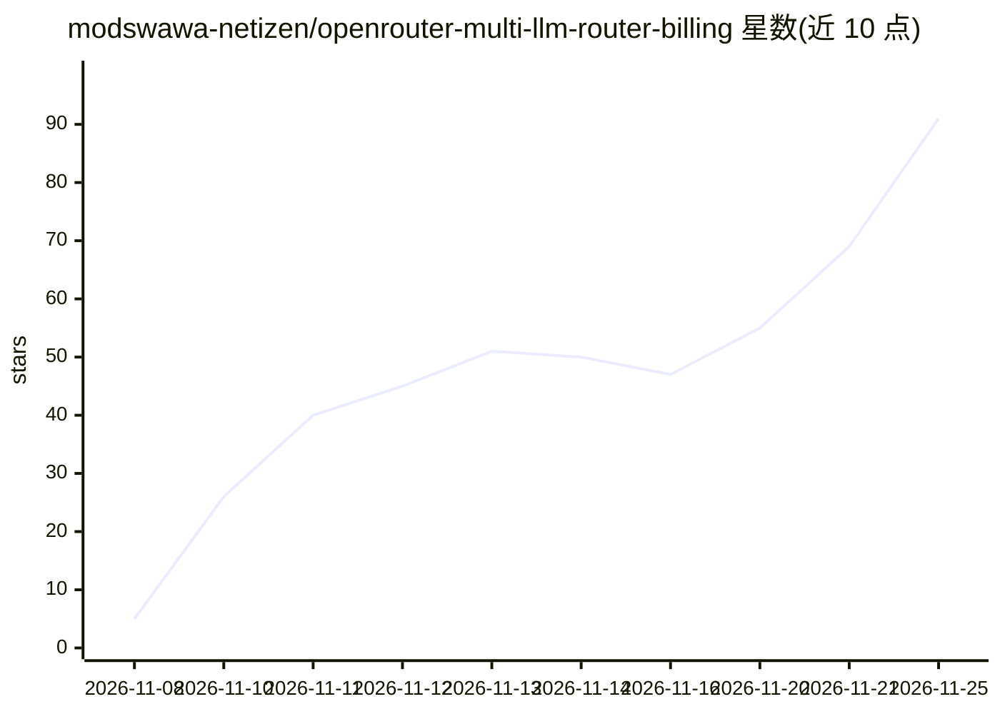

# modswawa-netizen/openrouter-multi-llm-router-billing

⭐ 91 · 推送 2026-11-06 · [GitHub](https://github.com/modswawa-netizen/openrouter-multi-llm-router-billing) · [官网](https://app.coregold.io/signup?invite_code=ADvlj9b) · 组织维护 · 中文 README

**推广 CoreGold 虚拟卡的文章：解决 AI 网关充值风控问题**

非软件仓库：README 为一篇营销性质文章，面向使用 OpenRouter/Together 等聚合网关的工程团队，讨论 Auto-Reload 跨国扣费被风控冻结、多团队分账困难等支付问题，并以对比表形式宣传 CoreGold 企业卡段（414742/556167）的 AVS 通过率与扣款稳定性，末尾引导至 CoreGold 开卡控制台。全文无代码、无安装步骤、无可运行组件，内容以引导开卡为目的，事实性断言（如秒级放行、资金秒级回流）均来自营销文案本身，无法独立验证。

## 筛选速览

| 维度 | 判定 | 备注 |
|---|---|---|
| AI 角色 | `ai-knowledge` | 知识聚合/清单类 |
| 许可风险 | `none` | — |
| 部署形态 | `None` |  |
| 模型依赖 | — | README 未给出锁定关系 |
| 硬件要求 | — | 无带数字的原话,不猜 |
| 安装摩擦 | `low` | 无编译、无系统依赖或容器化 |
| 成熟度 | — | 结构信号不足 |

## 能力要点

- 内容为支付/虚拟卡推广文案，非可安装或可运行的项目
- 讨论 OpenRouter/Together 聚合网关的 Auto-Reload 扣费风险场景
- 宣传 CoreGold 商业卡段并附开卡操作流程

## 适用场景

- 了解 AI 聚合网关充值场景下常见的支付风控问题描述（注意内容带推广性质）

## 场景标签

 · 领域:AI 网关计费/支付（推广内容）

## 证据(README 行号)

> L2: OpenRouter / Together 多模型网关充值避坑：CoreGold 商业虚拟卡破解 Auto-Reload 异地拒付与团队分账死锁。
> L35: 👉 **立即进入 CoreGold 开卡控制台**

## 星数曲线

2026-11-08 5 → 2026-11-25 91（+86）

---
*卡片 v1 · prompt 1.4 · 生成 2026-11-18 · 置信度 low · 依据 README sha `d3182f0a5d9b` · [字段定义](../../DATASET.md)*
