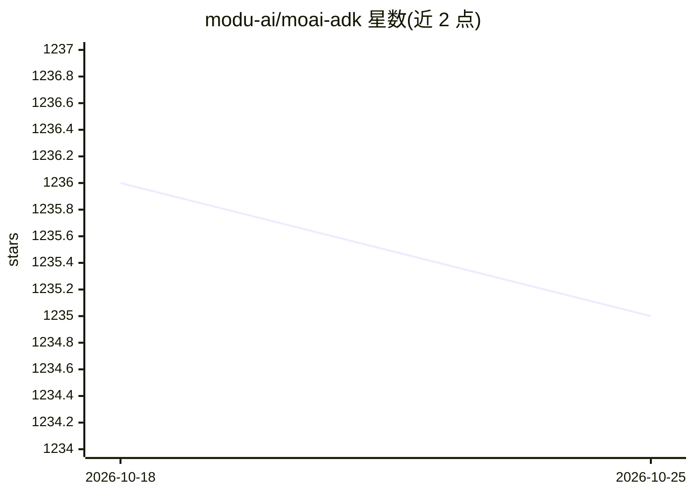

# modu-ai/moai-adk

⭐ 1,235 · Go · Apache-2.0 · 推送 2026-10-24 · [GitHub](https://github.com/modu-ai/moai-adk) · [官网](https://adk.mo.ai.kr) · 组织维护

**Claude Code 的验证驱动 agent 编排 harness，多会话并行开发**

面向 Claude Code（及 GLM、Codex 后端）的 agent 开发编排工具，以单个 Go 二进制交付、声明零依赖。核心是 SPEC 驱动的 plan→run→sync 流程与 Factory Mode：一个 leader 会话看管队列、多个编号 lane 会话各领一张卡片在独立 worktree 中走完全程；leader 只依据自己读取的 progress.md 证据推进卡片。提供 TRUST 5 质量门、模型与effort 路由、Claude×GLM 多 LLM 成本控制、SQLite 任务队列（/moai gtd）、本地 Web 控制台（moai web）与跨会话消息设置。限制：lane 需手动逐个终端启动，Codex 后端无 leader 入口。

## 筛选速览

| 维度 | 判定 | 备注 |
|---|---|---|
| AI 角色 | `ai-ecosystem` | LLM/agent 周边工具 |
| 许可风险 | `permissive` | Apache-2.0 |
| 部署形态 | `desktop` | 安装包/桌面程序 |
| 模型依赖 | — | README 未给出锁定关系 |
| 硬件要求 | — | 无带数字的原话,不猜 |
| 安装摩擦 | `low` | 无编译、无系统依赖或容器化 |
| 成熟度 | — | 结构信号不足 |

## 能力要点

- Factory Mode：leader 会话 + 多 lane 会话，卡片在单 lane 内完成 plan→run→sync
- leader 仅依据自己读取的 progress.md 证据推进卡片，不信 lane 回复
- 卡片分 A/B/C 三类，按类决定跳过 plan/SPEC 的流程路径
- 支持 Claude/GLM/Codex 多后端，按 lane 选后端并做多 LLM 成本控制

## 适用场景

- 把长 SPEC 的开发工作拆到多个并行会话，避免单一上下文窗口被占满
- 在 Claude Code 里以质量门与证据核验驱动 agent 编码
- 跨账号/多后端分摊会话压力（如遇 429 时分散 lane）

## 场景标签

`编码 Agent` `多智能体` · 领域:Agent 开发

## 证据(README 行号)

> L5:  A verification-driven agent orchestration harness — the structure that makes Claude Code's code trustworthy
> L30: Factory Mode splits the work across **one leader session and several numbered lane sessions**. The leader watches t
> L48: The backend is chosen per lane: `moai cc -l` is a Claude lane, `moai glm -l` a GLM lane, `moai codex -l` a Codex la

## 星数曲线

2026-10-18 1,236 → 2026-10-25 1,235（-1）

---
*卡片 v1 · prompt 1.4 · 生成 2026-10-21 · 置信度 high · 依据 README sha `413bec84210a` · [字段定义](../../DATASET.md)*
