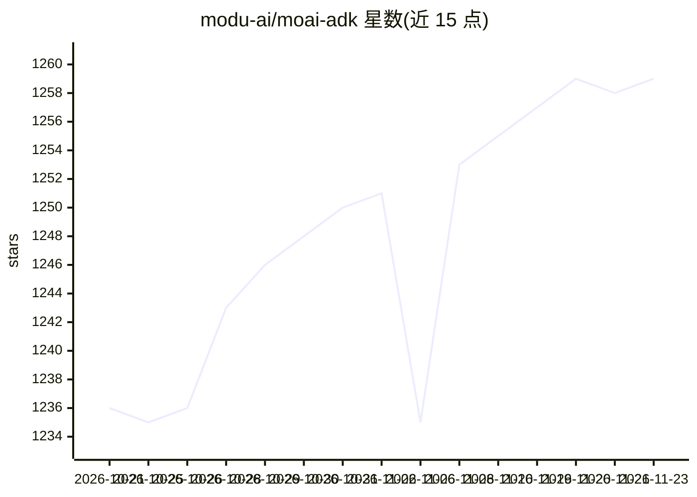

# modu-ai/moai-adk

⭐ 1,259 · Go · Apache-2.0 · 推送 2026-11-22 · [GitHub](https://github.com/modu-ai/moai-adk) · [官网](https://adk.mo.ai.kr) · 组织维护 · 中文 README

**Claude Code 的 agent 编排 harness：SPEC 驱动与多会话工厂模式**

以单个 Go 二进制分发的 agentic 开发工具，围绕 Claude Code 提供 SPEC 驱动的 plan/run/sync 流程与 TRUST 5 质量门。v3.2 的 Factory Mode 将工作拆分到 leader 会话与多个编号 lane 会话，卡片按 A/B/C 三类决定经过的阶段，任务通过 /moai gtd 经 Capture→Engage 进入 backlog 队列；lane 后端可按条选 Claude 或 GLM，提供本地 web 控制台、home 目录清理与跨会话消息配置。面向使用 Claude Code 进行团队/个人开发的工程师。

## 筛选速览

| 维度 | 判定 | 备注 |
|---|---|---|
| AI 角色 | `ai-ecosystem` | LLM/agent 周边工具 |
| 许可风险 | `permissive` | Apache-2.0 |
| 部署形态 | `desktop` | 安装包/桌面程序 |
| 模型依赖 | locked-api |  |
| 硬件要求 | — | 无带数字的原话,不猜 |
| 安装摩擦 | `low` | 无编译、无系统依赖或容器化 |
| 成熟度 | — | 结构信号不足 |

## 能力要点

- 单 Go 二进制、零依赖、支持 16 种语言
- Factory Mode：leader+多 lane 会话并行处理卡片，lane 限定 10 个子 agent
- 任务队列基于 SQLite，操作回执防止崩溃后重复发布
- moai web 本地控制台查看 lanes、SPEC 管线与监控

## 适用场景

- 多会话并行推进多个开发卡片
- 通过质量门控制 Claude 生成代码的可信度
- 按成本混合 Claude 与 GLM 后端

## 场景标签

`多智能体` `编码 Agent` · 领域:Agent 开发

## 证据(README 行号)

> L5:  A verification-driven agent orchestration harness — the structure that makes Claude Code's code trustworthy
> L47: The backend is chosen per lane: `moai cc -l` is a Claude lane, `moai glm -l` a GLM lane. The leader's seat is not f

## 星数曲线

2026-10-21 1,236 → 2026-11-23 1,259（+23）

---
*卡片 v1 · prompt 1.4 · 生成 2026-11-23 · 置信度 high · 依据 README sha `836ef53e3cd6` · [字段定义](../../DATASET.md)*
