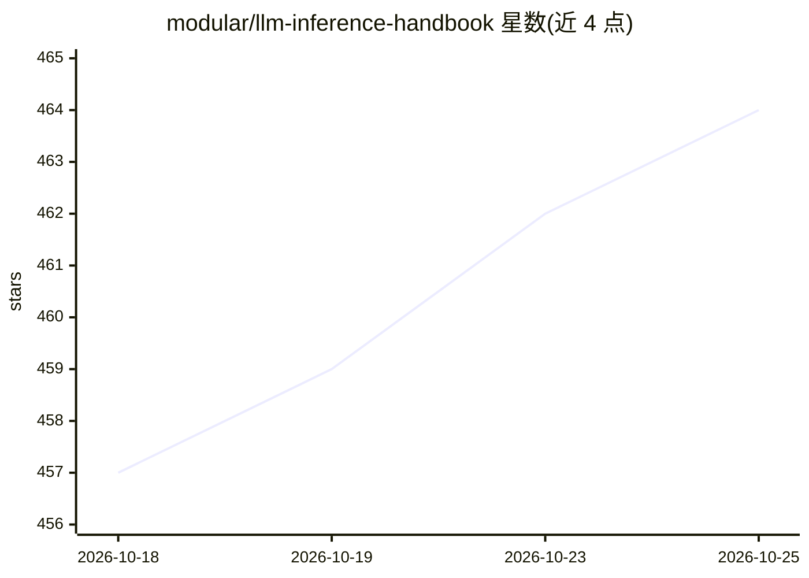

# modular/llm-inference-handbook

⭐ 464 · TypeScript · Apache-2.0 · 推送 2026-10-23 · [GitHub](https://github.com/modular/llm-inference-handbook) · [官网](https://handbook.modular.com/) · 组织维护

**LLM 推理系统的实践指南（Docusaurus 站点源码）**

由 Modular 维护的 LLM Inference Handbook 仓库，内容为理解、优化、扩展和运维 LLM 推理系统的实践指南，以 Docusaurus 静态站点形式构建并采用 Modular 设计语言。README 主要面向贡献者：通过 pnpm 安装依赖并本地预览（localhost:3000）、构建生产版本、用 rumdl 进行 Markdown lint（含 VS Code 扩展与 LSP 集成），并附贡献与许可说明。正文内容不在 README 中展开。

## 筛选速览

| 维度 | 判定 | 备注 |
|---|---|---|
| AI 角色 | `ai-knowledge` | 知识聚合/清单类 |
| 许可风险 | `permissive` | Apache-2.0 |
| 部署形态 | `library` | 以包/库形式分发 |
| 模型依赖 | — | README 未给出锁定关系 |
| 硬件要求 | — | 无带数字的原话,不猜 |
| 安装摩擦 | `low` | 无编译、无系统依赖或容器化 |
| 成熟度 | — | 结构信号不足 |

## 能力要点

- 覆盖 LLM 推理的理解、优化、扩展与运维
- Docusaurus 站点，pnpm 本地预览与构建
- rumdl Markdown lint 与编辑器集成配置

## 适用场景

- 查阅 LLM 推理系统的优化与运维知识
- 本地构建或贡献手册内容

## 场景标签

`教程课程` · 领域:学习与行业

## 证据(README 行号)

> L4: LLM Inference Handbook, a practical guide for
> L5: understanding, optimizing, scaling, and operating LLM inference systems.

## 星数曲线

2026-10-18 457 → 2026-10-25 464（+7）

---
*卡片 v1 · prompt 1.4 · 生成 2026-10-22 · 置信度 mid · 依据 README sha `9b2ddcbef647` · [字段定义](../../DATASET.md)*
