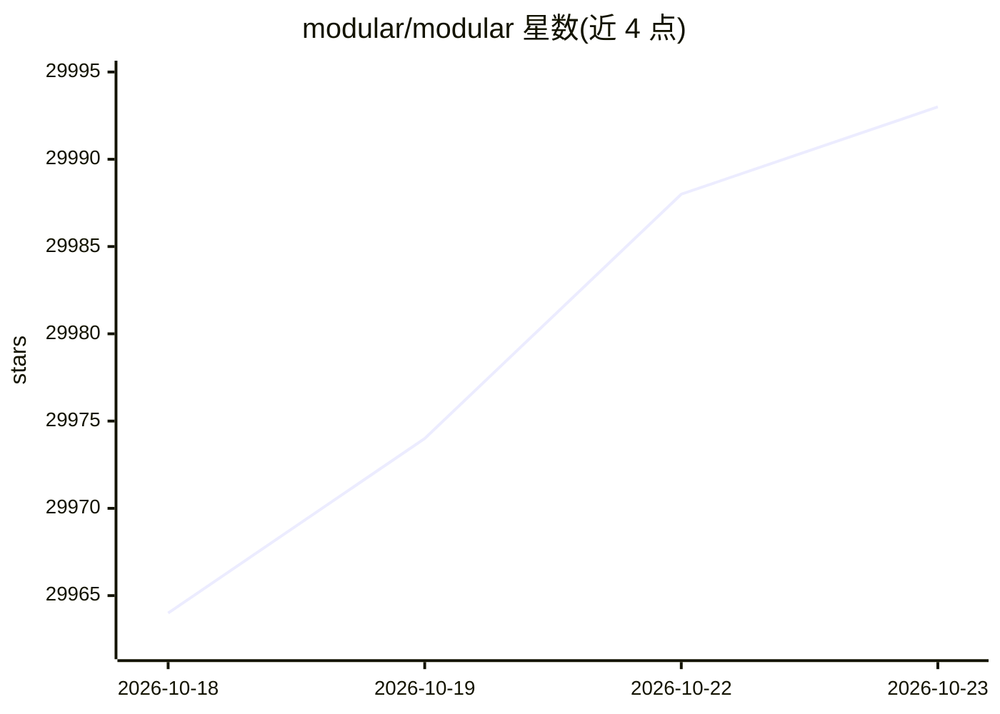

# modular/modular

⭐ 29,993 · Mojo · NOASSERTION · 推送 2026-10-22 · [GitHub](https://github.com/modular/modular) · [官网](https://docs.modular.com/) · 组织维护

**面向 AI 开发与部署的平台：MAX 框架 + Mojo 语言**

该仓库托管 Modular Platform 的开源组件，覆盖 AI 开发与部署全链路：MAX 框架提供模型创作（Python）、推理服务端（OpenAI 兼容端点）、Mojo 编写的计算内核与 GPU 编程抽象、模型流水线；Mojo 语言提供编译器与标准库。README 指出正持续开源更多组件，即当前并非全部源码开放。接受两部分代码的贡献与 bug 报告，采用 Apache License v2.0，并提示用户自行核验第三方（如 Hugging Face）下载内容的许可证。

## 筛选速览

| 维度 | 判定 | 备注 |
|---|---|---|
| AI 角色 | `ai-ecosystem` | LLM/agent 周边工具 |
| 许可风险 | `none` | NOASSERTION |
| 部署形态 | `None` |  |
| 模型依赖 | — | README 未给出锁定关系 |
| 硬件要求 | — | 无带数字的原话,不猜 |
| 安装摩擦 | `low` | 无编译、无系统依赖或容器化 |
| 成熟度 | — | 结构信号不足 |

## 动量与使用信号

- 维护:`active` — 距上次 push 0.8 天,年发版 7,389 位贡献者
- 涨星:近 1 天 **+6**(自 20261016 起算)
- 平台:— · 协议:OPENAI-API

## 能力要点

- MAX 推理服务器提供 OpenAI 兼容端点
- Mojo 编译器与标准库已开源
- MAX 内核与 GPU 编程抽象以 Mojo 编写
- Apache License v2.0 许可

## 适用场景

- 部署兼容 OpenAI 接口的模型推理服务
- 用 Python 进行模型创作与构建流水线
- 用 Mojo 编写 GPU 计算内核
- 参与 Mojo/MAX 的开源贡献

## 场景标签

`推理引擎` · 领域:训练与推理

## 证据(README 行号)

> L5: This repo hosts open-source components of the Modular Platform,
> L6: a unified platform for AI development and deployment,
> L35: - MAX inference server: /max/python/max/serve

## 星数曲线

2026-10-18 29,964 → 2026-10-23 29,993（+29）

---
*卡片 v1 · prompt 1.4 · 生成 2026-10-18 · 置信度 high · 依据 README sha `202f93357ca3` · [字段定义](../../DATASET.md)*
