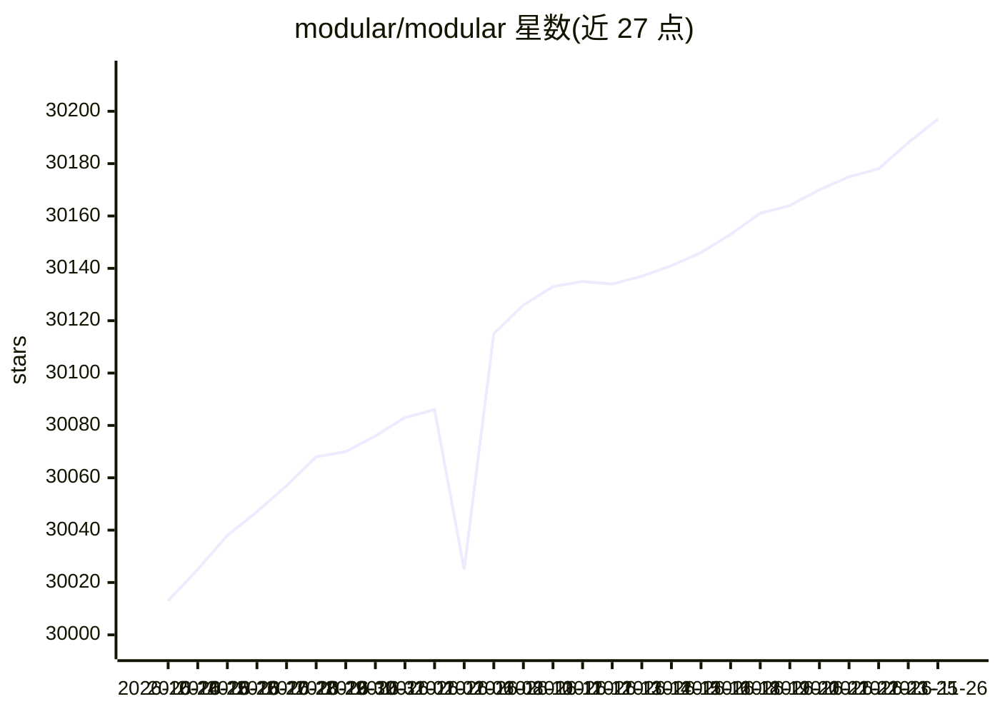

# modular/modular

⭐ 30,197 · Mojo · NOASSERTION · 推送 2026-11-25 · [GitHub](https://github.com/modular/modular) · [官网](https://docs.modular.com/) · 组织维护

**面向 AI 开发与部署的平台，含 MAX 框架与 Mojo 语言**

该仓库托管 Modular Platform 的开源组件：Mojo 编程语言（编译器与标准库）、MAX AI 框架、图编译器、推理运行时与推理服务器（提供 OpenAI 兼容端点）、GPU 编程抽象与 Mojo 计算内核、模型流水线及示例代码。面向在自己的项目中使用 MAX 与 Mojo 构建和部署 AI 的开发者，可通过 bazel 从仓库源码运行 mojo 或 max 命令，运行 max 生成文本需要兼容的 GPU。项目按 Apache License v2.0 授权，并声明将持续开源更多组件。

## 筛选速览

| 维度 | 判定 | 备注 |
|---|---|---|
| AI 角色 | `ai-ecosystem` | LLM/agent 周边工具 |
| 许可风险 | `none` | NOASSERTION |
| 部署形态 | `None` |  |
| 模型依赖 | — | README 未给出锁定关系 |
| 硬件要求 | — | 无带数字的原话,不猜 |
| 安装摩擦 | `low` | 无编译、无系统依赖或容器化 |
| 成熟度 | — | 结构信号不足 |

## 动量与使用信号

- 维护:`active` — 距上次 push 0.8 天,年发版 7,389 位贡献者
- 涨星:近 1 天 **+6**(自 20261016 起算)
- 平台:— · 协议:OPENAI-API

## 能力要点

- Mojo 编译器、标准库与 GPU 编程抽象开源
- MAX 提供图编译器、运行时与 OpenAI 兼容推理服务器
- Python 模型编写接口与模型流水线
- Apache License v2.0 授权

## 适用场景

- 用 Mojo 编写并在仓库中直接运行源码
- 通过 MAX 推理服务器部署 OpenAI 兼容端点
- 基于 MAX 框架用 Python 编写模型与流水线

## 场景标签

`推理引擎` · 领域:训练与推理

## 证据(README 行号)

> L5: This repo hosts open-source components of the Modular Platform,
> L47: - MAX runtime: /MLRT
> L53: - MAX inference server: /max/python/max/serve

## 星数曲线

2026-10-24 30,013 → 2026-11-26 30,197（+184）

---
*卡片 v1 · prompt 1.4 · 生成 2026-11-22 · 置信度 high · 依据 README sha `f8b2b1ec951b` · [字段定义](../../DATASET.md)*
